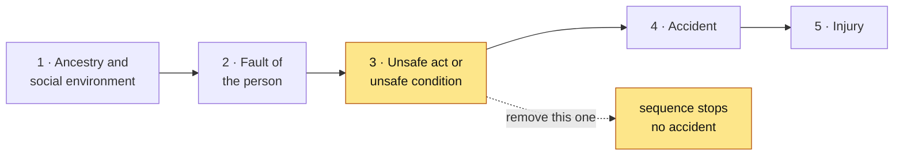
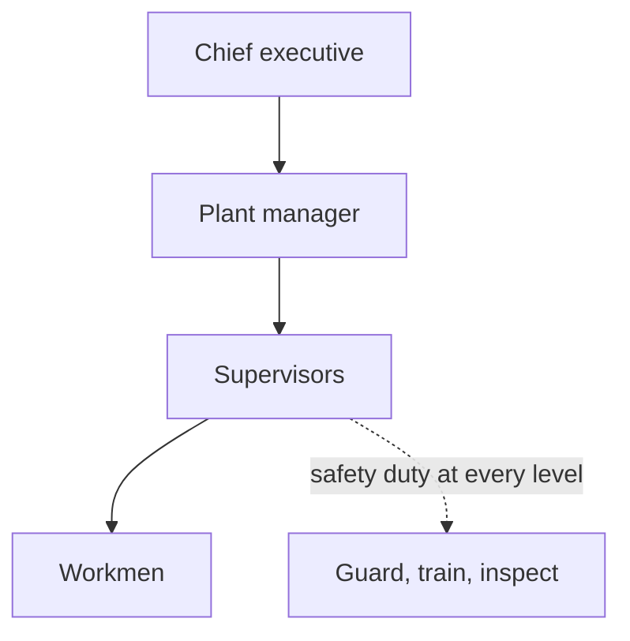
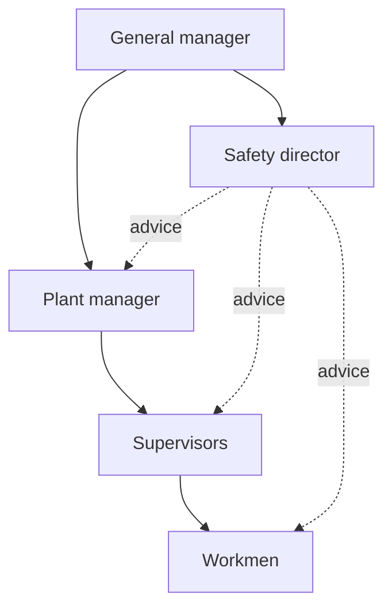
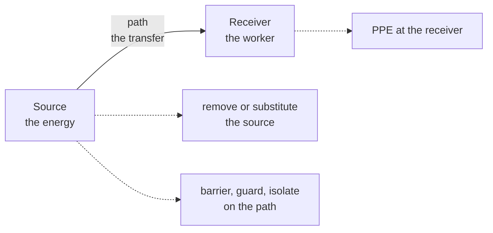
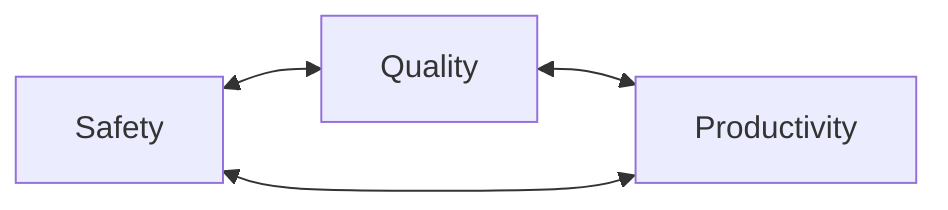
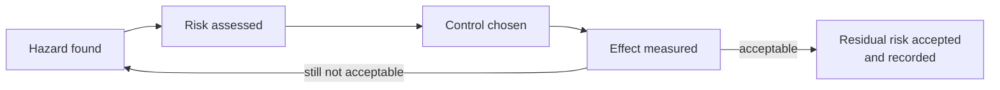

# Module 1 — Introduction to Industrial Safety Engineering

> 20MCN401 · B.Tech CSE Sem 7 (Saintgits, autonomous) · 0-credit, mandatory · this module carries 20% of the ESE — assume two Part-A questions (3 marks) and one Part-B (14 marks). Source: `m1.txt`, cited as (`slide N`). Anything marked **(standard)** is exam-standard content that the deck does not carry.

---

## 1. Coverage

**Table A — syllabus line to section.**

| Syllabus line (verbatim) | Hrs | Answered at § |
|---|---|---|
| Need for safety — safety and productivity | 1 | §2.1, §2.2 |
| Definitions: accident, injury, unsafe act, unsafe condition, dangerous occurrence, reportable accidents | 1 | §2.3 |
| Theories of accident causation — safety organisation | 1 | §2.4, §2.5 |
| Role of management, supervisors, workmen, unions, government and voluntary agencies in safety | 1 | §2.6, §2.7, §2.8 |
| Safety officer — responsibilities, authority | 1 | §2.9 |
| Safety committee — need, types, advantages | 1 | §2.10 |

**Table B — the 32 Module I questions.** Marks are the weight I would give each one; the bank did not record them.

| Q# | Asked | Marks | Answered at § |
|---|---|---|---|
| Q19 | State the objectives of safety in an industry | 3 | §3.1 · §2.1 |
| Q20 | Enlist the functions of safety committee | 3 | §3.1 · §2.10 |
| Q21 | How do unions play an important role in safety? Give an example | 5 | §3.2 · §2.7 |
| Q22 | Describe the need for safety in an industry | 3 | §3.1 · §2.1 |
| Q23 | List the major theories of accident causation | 3 | §3.1 · §2.4 |
| Q24 | Discuss the importance of the Domino theory | 5 | §3.2 · §2.4 |
| Q25 | Define safety organisation | 3 | §3.1 · §2.5 |
| Q45 | Explain the role of management in safety | 5 | §3.2 · §2.6 |
| Q46 | Explain the role of the union in safety | 5 | §3.2 · §2.7 |
| Q47 | Explain the responsibilities of management and unions in safety | 8 | §3.3 · §2.6, §2.7 |
| Q48 | Explain the role of the safety officer | 5 | §3.2 · §2.9 |
| Q49 | Explain safety committee | 3 | §3.1 · §2.10 |
| Q50 | Explain the types of safety committee | 3 | §3.1 · §2.10 |
| Q84 | Discuss the relation between safety and productivity | 8 | §3.3 · §2.2 |
| Q85 | Describe (a) dangerous occurrence, (b) unsafe condition | 5 | §3.2 · §2.3 |
| Q86 | Describe (a) accident, (b) reportable accidents | 5 | §3.2 · §2.3 |
| Q87 | Major theories; Domino and human factors in detail | 8 | §3.3 · §2.4 |
| Q88 | Major theories; systems theory and human factors in detail | 8 | §3.3 · §2.4 |
| Q89 | Describe safety organisation and its major benefits | 8 | §3.3 · §2.5 |
| Q116 | Explain the role of workmen in safety | 5 | §3.2 · §2.7 |
| Q117 | Explain the role of supervisors in safety | 5 | §3.2 · §2.6 |
| Q118 | Explain the responsibility of the safety officer | 8 | §3.3 · §2.9 |
| Q120 | What are the functions and duties of a safety committee | 8 | §3.3 · §2.10 |
| Q136 | Describe with examples (a) accident, (b) injury, (c) unsafe act | 5 | §3.2 · §2.3 |
| Q137 | Enumerate any five needs of ensuring safety | 5 | §3.2 · §2.1 |
| Q138 | Describe any three theories that explain accident causes | 8 | §3.3 · §2.4 |
| Q139 | Explain any three major theories of accident causation | 8 | §3.3 · §2.4 |
| Q140 | Discuss three major theories of how accidents occur | 8 | §3.3 · §2.4 |
| Q141 | Roles of management, supervisors, workmen and unions | 14 | §3.4 · §2.6, §2.7 |
| Q142 | How management, supervisors, workers and unions maintain safety | 14 | §3.4 · §2.6, §2.7 |
| Q143 | Responsibilities and authorities of a safety officer | 8 | §3.3 · §2.9 |
| Q144 | What is the need for a safety committee | 3 | §3.1 · §2.10 |

Not this module, though the wording looks close. Rates, PPE standards, housekeeping and 5S, and work permits belong to Module II. Fire classes belong to Module V.

---

## 2. Concepts

### 2.1 Need for safety (`slide 10`, `slide 11`, `slide 12`)

*In plain English.* A plant that hurts people is a plant that loses money. The loss arrives twice: once as the accident, and again as the slow drag on output afterwards. So safety spending is not charity and it is not paperwork. Think of servicing a machine before it seizes, not after.

*The detail.*
- **Two benefit columns on the deck.** Seven benefits to the organisation (`slide 11`), seven to the employee (`slide 12`).
- **Organisation side, money.** Lower costs, less waste, better use of resources, no fine for breaking the rules.
- **Organisation side, output.** Efficiency rises, because workers stop worrying and start producing.
- **Employee side.** Higher earnings, better morale, less worry, more motivation, more time on quality.
- **The name to quote.** The ILO observes **28 April** as the World Safety and Health Day (`slide 10`).
- **The trade-off in one line.** Prevention costs a little; an emergency costs a great deal (`slide 18`).
- **What an accident costs.** Wages, downtime, repair and the fine. Every one is avoidable (`slide 11`).
- **Why the deck splits the list.** An employer hears the money argument, and a worker hears the safety argument (`slide 10`).
- **Objectives are a different list (standard).** Prevent injury, prevent damage, meet the legal duty, keep production running, build a safety culture.

The deck's seven organisation benefits collapse into four pairs. Write the pairs and you have covered the list.

| Benefit to the organisation | Benefit to the employee |
|---|---|
| Lower costs, less waste, better use of resources | Higher earnings when the company earns more |
| Fewer financial losses when accidents are avoided | Better morale and stronger motivation |
| No penalty for breaking a safety rule | Less worry about personal safety |
| Productivity and efficiency both rise | More time on the quality and quantity of output |

*What to write (3 marks).* One line for the organisation's gains. One line for the employee's gains. One line carrying the ILO date. Do not narrate a single accident.

**Mark anchor.** "28 April — the ILO World Safety and Health Day", paired with "seven benefits to the organisation, seven to the employee".

**Exam trap.** "Need for safety" asks **why spend the money**. "Objectives of safety" asks **what the money aims at**. Handing the seven benefits to an objectives question earns half marks at best, and the reverse fails the same way.

### 2.2 Safety and productivity (`slide 13` to `slide 20`)

*In plain English.* Most managers treat safety as a brake on output. The deck argues the opposite: safety, quality and productivity are three legs of one stool. Pull one leg and the stool falls, whichever leg you pulled. A safe plant is simply a plant that is not being interrupted.

*The detail.*
- **Three pillars** (`slide 14`): safety, quality and productivity. The deck says they "operate in concert", not in competition.
- **The sentence to quote.** The deck calls the three "inextricably linked" (`slide 13`).
- **Safety drives the other two.** Unsafe operations are badly managed operations. Stressed workers produce poor work (`slide 15`).
- **Quality drives the other two.** High quality means fewer reworks, so output rises. High standards in one area predict high standards in safety (`slide 16`).
- **Productivity drives the other two.** Carelessness causes accidents. Productive workers have less reason to cut corners (`slide 17`).
- **The first barrier.** Managers fear that safety costs time and money (`slide 18`).
- **The second barrier.** Managers think they must choose fast, cheap or good. Cheap and fast forces quality down (`slide 19`).
- **The cost of that choice.** Rework after a lost customer can reach **three times the original budget** (`slide 19`).
- **The third barrier.** Safety and productivity are assumed to be mutually exclusive (`slide 20`).
- **The deck's own line.** Spend a small amount on preventative care, not a large amount on an emergency (`slide 18`).
- **Who holds which view.** The floor treats safety as an inspector's visit; the board treats it as a cost line (`slide 18`).
- **Why the argument keeps returning.** A good safety year looks like money that was never needed (`slide 18`).

The chain to remember, in four links: unsafe work interrupts production, interruption costs money, money buys less safety, and the plant spirals down.

*What to write (8 marks).* Define the three pillars. Give one mechanism for each direction of influence. Name the three barriers and answer each. Close with the three-times rework figure as evidence.

**Mark anchor.** "Rework can reach three times the original budget" (`slide 19`). It converts a soft claim into a number.

**Exam trap.** If the question asks whether safety **reduces** productivity, the deck's answer is **no**. Safety is a precondition for productivity, not a tax on it. Conceding the premise loses the argument marks even if every example is right.

### 2.3 Definitions — the six terms (`slide 21` to `slide 26`)

*In plain English.* These six words are the vocabulary the rest of the course runs on. An accident is the event. An injury is the damage to a person. An unsafe act is something a person did. An unsafe condition is something the workplace was. A dangerous occurrence is the accident that nearly happened. A reportable accident is the one the law makes you report. Get the order right and half the paper answers itself.

*The detail.*
- **Accident, ordinary sense.** An unforeseen and unexpected event (`slide 21`).
- **Accident, Heinrich's wording.** "An unplanned and uncontrolled event in which the action or reaction on an object, substance, person or radiation results in personal injury" (`slide 21`). The deck credits this to Heinrich.
- **Accident, council wording.** The deck attributes a second definition to the American Safety Council: an occurrence in a sequence of events producing unintended injury, death or property damage (`slide 21`).
- **Injury.** An abnormal condition or disorder. Cuts, fractures, sprains, amputations, plus acute and chronic illness (`slide 24`).
- **Injury, legal sense.** Mental or physical harm caused by accident or disease, including damage to artificial limbs, teeth, hearing aids and glasses (`slide 25`).
- **Industrial injury.** Injury or occupational disease arising out of employment, and so compensable under the **Workmen's Compensation Act, 1923** (`slide 26`).
- **Unsafe act (standard).** A human action that breaks a safe procedure and creates a hazard, such as removing a guard.
- **Unsafe condition (standard).** A physical state of the workplace that departs from the safe standard, such as an unguarded belt.
- **Dangerous occurrence (standard).** A listed near-miss that harmed nobody but could have. The Factories Act, 1948 requires notice of these.
- **Reportable accident (standard).** One the law says you must notify. Under the Factories Act that means death, or injury stopping work for **48 hours** or more.

*What to write (5 marks).* One line per term, each with the plain sense first. Add one example per term. Name the Act only where the question asks for the legal meaning.

**Mark anchor.** "88% unsafe acts, 10% unsafe conditions, 2% acts of God — Heinrich, 1932" (`slide 41`). It separates act from condition with a number.

**Exam trap.** **Unsafe act** is a behaviour; **unsafe condition** is a state. A missing guard is a condition. Reaching past the guard is an act. The two are reported separately, and swapping them changes who gets blamed, so the marker notices.

### 2.4 Theories of accident causation (`slide 39` to `slide 54`)

*In plain English.* A theory of causation is a story about why the accident happened. Each story tells you where to push to stop the next one. Push on the worker and you get training. Push on the machine and you get guarding. Push on the system and you get procedures. Nine stories are on the menu, and the paper asks for two or three of them by name.

*The detail.*
- **The deck's framing.** No theory is universally accepted. Prediction is hard, so the search continues (`slide 39`).
- **Eight theories are listed** (`slide 40`). Systems theory is the ninth, and it is not on the deck at all.
- **Domino** (`slide 41`): Heinrich, **1932**. Five factors topple in sequence, each pushing the next.
- **The five factors.** Ancestry and social environment, worker fault, unsafe act with a hazard, the accident, then damage or injury.
- **Where to cut the chain.** Remove **factor three**, the unsafe act or condition. That is Heinrich's key domino (`slide 44`).
- **The split.** 88% unsafe acts, 10% unsafe conditions, 2% acts of God (`slide 41`).
- **Multiple causation** (`slide 48`): grows out of Domino. Many contributory causes combine, in behavioural and environmental groups.
- **Pure chance** (`slide 49`): every worker has an equal chance. No pattern, so no intervention is possible.
- **Biased liability** (`slide 50`): after one accident, that worker's odds shift up or down. Contributes little to prevention.
- **Accident proneness** (`slide 51`): a subset of workers is more liable. Unproven, and not generally accepted.
- **Energy transfer** (`slide 52`): injury happens when energy changes form. Every change has a source, a path and a receiver.
- **Energy controls** (`slide 53`): remove the source; at the path use barriers, enclosures, absorbers, isolators; at the receiver limit exposure and issue PPE.
- **Symptoms versus causes** (`slide 54`): unsafe acts and conditions are symptoms, the proximate causes. The root cause sits further back.
- **Human factors (standard).** Overload, then a wrong decision, then a wrong action. The worker is overloaded by workload, stress or environment.
- **Systems theory (standard).** Person, machine, environment and management interact. A fault in one part propagates, so you fix the system.

| Theory | Core claim | Attribution |
|---|---|---|
| Domino | Five factors topple in sequence; cut one and the chain stops | Heinrich, 1932 |
| Human factors | Overload leads to a bad decision, then to a bad action | (standard) |
| Multiple causation | Many causes combine, behavioural and environmental | Outgrowth of Domino |
| Pure chance | Equal odds for everyone; no pattern to find | `slide 49` |
| Biased liability | One accident changes that worker's future odds | `slide 50` |
| Accident proneness | A subset of workers is inherently more liable | Unproven |
| Energy transfer | Injury is a change of energy, from source to receiver | `slide 52` |
| Symptoms versus causes | Acts and conditions are symptoms, not root causes | `slide 54` |
| Systems (standard) | Accidents emerge from interaction between system parts | (standard) |

*What to write (8 marks).* Name the theory and its author. State the mechanism in one line. Give one control that follows from it. Repeat for the second theory. Finish with one line on why no theory is accepted universally.

**Mark anchor.** "Heinrich, 1932 — five factors, and factor three is the one to remove." The number and the year prove you read a primary source. A summary would not carry both.

**Exam trap.** **Domino** says the chain is linear, so removing one link stops it. **Multiple causation** says many links act together, so removing one link may change nothing. If the answer to "how do you prevent it" is a single fix, you are writing Domino whether you meant to or not.

### 2.5 Safety organisation (`slide 59` to `slide 68`)

*In plain English.* A safety organisation is the group of people whose job is to keep the plant safe, plus the lines of authority that let them do it. The question is always the same: does the safety person give orders, or give advice? Give orders and you have a line organisation. Give advice and you have a staff organisation. The whole topic is that one fork in the road.

*The detail.*
- **Purpose** (`slide 59`): assist management to run a programme that protects employees and raises production. It touches manpower, material, machinery, equipment and time.
- **Four bodies the deck names** (`slide 59`): World Safety Organization, the Occupational Safety and Health Administration, National Safety Council, American Society of Safety Professionals.
- **Line organisation** (`slide 61`): authority runs from the top down, supervisor over subordinate. Also called military or scalar.
- **Line in practice.** Safety duties are handed out beside production duties. One person controls both people and physical conditions.
- **Line advantages** (`slide 63`): clear chain of command, quick decisions, clear accountability, direct control of the work area.
- **Line disadvantages** (`slide 64`): no specialist keeps up with new safety practice, training is rare, the chief executive is too busy, supervisors correct causes only after the accident.
- **Staff organisation** (`slide 65`): a line structure plus specialists who advise every level. A safety director reports to the general manager.
- **Staff advantages** (`slide 67`): the director has specialist experience, can stop a hazardous operation at once, represents the firm outside, keeps executives informed, and can run training.
- **Staff disadvantages** (`slide 68`): it costs extra staff, does not suit a small plant, and tempts managers to dump safety on the director.

| | Line organisation | Staff organisation |
|---|---|---|
| Authority | Direct, top to bottom | Advice to every level |
| Who owns safety | The supervisor, beside production | The safety director, advising |
| Strength | Fast, unambiguous, accountable | Expert, trained, current |
| Weakness | No specialist, fixes after the event | Costly, invites buck-passing |

*What to write (8 marks).* Define the purpose in one line. Name the two types. Give two advantages and two disadvantages for each. Close with one line on which suits a small plant.

**Mark anchor.** "Line = authority, staff = advice; the staff model adds a safety director reporting to the general manager" (`slide 65`).

**Exam trap.** A staff organisation does **not** remove the supervisor's duty. It adds expert help and leaves accountability where it was. Writing "in a staff organisation safety is the safety director's responsibility" is the classic lost mark, because that is exactly the weakness `slide 68` warns about.

### 2.6 Role of management and supervisors (`slide 69` to `slide 71`)

*In plain English.* Management decides what the plant is willing to spend on safety, so management sets the ceiling. The supervisor works under that ceiling, at the point where the job actually happens. Management writes the rule. The supervisor makes sure the rule survives contact with a bad Tuesday. If management only talks and the supervisor only walks past, nothing changes.

*The detail.*
- **Six management duties** (`slide 69`): design safer systems of work, show commitment, inspect the workplace, set procedures and controls, run training, set up the safety committee.
- **Design comes first.** A safer system of work removes the hazard before anyone needs protecting from it.
- **Commitment is visible or it is absent.** Workers copy what managers do, not what the policy says.
- **Inspection finds drift.** Guards get removed, aisles get blocked, and only a walk finds it (`slide 70`).
- **Supervisor duty one.** Resolve safety issues raised by the crew, and resolve them promptly (`slide 70`).
- **Supervisor duty two.** Walk the area routinely and ask the crew what is wrong.
- **Supervisor duty three.** Report back: inspection results, investigation findings, trends, fixes.
- **Supervisor duty four.** Put resources behind safety, so it is part of the task and not an add-on.
- **Supervisor duty five.** Set unit safety goals with the crew and attend the safety team meeting.
- **Supervisor duty six.** Make sure every worker knows the physical and chemical hazards and their controls.
- **Supervisor duty seven.** Let workers join inspections, investigations and hazard assessments.
- **Supervisor duty eight.** Hold monthly safety meetings, in person (`slide 71`).
- **Supervisor duty nine.** Make sure workers can explain stop-work authority, the discipline policy and the safety policy.
- **Supervisor duty ten.** Hold people accountable, with constructive feedback through the year.
- **The employer's side of the deal.** The supervisor needs training, information and backup to be effective (`slide 71`).

*What to write (5 marks).* Split the page into two columns, management and supervisor. Give three duties under each. Add one line on why the supervisor cannot do the job without employer backup.

**Mark anchor.** "Stop-work authority" (`slide 71`). It is the supervisor's sharpest tool and the marker looks for it.

**Exam trap.** Management **designs** the system; the supervisor **operates** it. If the question says "role of management" and you list walking the floor and holding toolbox talks, you have described the supervisor and lost half the marks.

### 2.7 Role of workmen and unions (`slide 72` to `slide 74`)

*In plain English.* The worker is the last person standing between the hazard and the injury, so the worker carries duties that cannot be delegated upwards. The union is the organised version of that voice. Where a union runs a safety committee, the crew has a body that can raise a hazard without any one worker risking his job. One worker alone is a complaint. A union committee is a process.

*The detail.*
- **The worker owns his own safety** (`slide 72`). That is the deck's first line and the one to quote.
- **The right to refuse.** A worker may refuse an act or a tool when he has reasonable cause to believe it would endanger him.
- **Dress and equipment.** Wear clothing suited to the site. Use the PPE the employer provides or the job demands.
- **The limit on refusal.** The belief must be reasonable, not a dislike of the task (`slide 72`).
- **Never strip a guard.** Do not remove a shield from a grinder, mixer or similar machine (`slide 72`).
- **Be trained first.** Get adequate instruction on a machine before using it.
- **Protect the next person.** Never use a tool in a way that could injure somebody else (`slide 73`).
- **Keep the routes clear.** Safe entrances, exits and movement paths for people, equipment and materials.
- **Eye protection.** Wear it on grinders and on any job that threatens the eyes.
- **Six union duties** (`slide 74`): survey members on safety concerns, investigate injuries and near-misses, monitor conditions, educate members, plan how to get issues fixed, file and follow up complaints.
- **Why unions do it.** A union committee signals commitment to both workers and employers, and acts as a watchdog.
- **The deck's caution.** Employers often feel safety is theirs alone. Unions still have the right to form independent committees (`slide 74`).

*What to write (5 marks).* Three worker duties with the right to refuse named first. Two union duties. One closing line on the watchdog role.

**Mark anchor.** "The right to refuse unsafe work" plus "union health and safety committees investigate injuries and near-misses" (`slide 72`, `slide 74`).

**Exam trap.** The union's job is **represent and monitor**, not **manage**. If your union answer has the committee issuing work permits or buying guards, you have handed it management's authority, and the marker will mark it wrong.

### 2.8 Role of government and voluntary agencies (`slide 75` to `slide 77`)

*In plain English.* The government sets the floor. It passes laws, writes standards and sends inspectors, so a bad employer cannot win by cutting safety. Voluntary agencies raise the ceiling. They publish guidance, run training and share good practice, with no power to fine anyone. Law without education is resisted. Education without law is ignored. You need both.

*The detail.*
- **Six statutes the deck lists** (`slide 75`): Factories Act 1948, Mines Act 1952, Indian Boilers Act 1923, Workmen's Compensation Act, Petroleum Act 1934, Indian Electricity Act.
- **The deck gives two Electricity Act years**, 1884 and 1910. Quote the pair rather than picking one (`slide 75`).
- **The limit of law.** Legislation alone cannot deliver safety (`slide 75`).
- **What else is needed.** Safe design, protection devices, PPE, and procedures that people actually follow.
- **The standards body.** The Indian Standards Institute lays down safety precautions for manufacturing (`slide 76`).
- **Standards, part two.** Maintenance of tools, layout, lighting and ventilation of factory buildings.
- **Standards, part three.** Safe welding and cutting, powered trucks, conveyors, fire-fighting equipment.
- **Standards, part four** (`slide 77`): classification and labelling of hazardous chemicals, handling codes for acids.
- **Standards, part five.** PPE specifications for eyes, ears, lungs, hands, feet and legs, plus fire safety in industrial buildings.
- **Voluntary agencies (standard).** Professional bodies and councils publish codes, run training and campaign. They advise; they do not prosecute.
- **The bodies the deck names** (`slide 59`): World Safety Organization, National Safety Council, American Society of Safety Professionals.
- **The exception in that list.** OSHA is a regulator, not a voluntary body, so do not file it with the other three.
- **What a voluntary body adds.** Guidance reaches places an inspector never visits, and it is updated faster than a statute.

*What to write (5 marks).* Three lines on government: legislation, standards, enforcement. Two lines on voluntary agencies: guidance and training. Close with the deck's line that law alone is not enough.

**Mark anchor.** "Factories Act 1948" is the statute to name first, and "legislation alone cannot ensure safety" is the sentence that earns the analysis mark.

**Exam trap.** The **government** can prosecute; a **voluntary agency** can only persuade. Do not credit the National Safety Council with statutory power, and do not credit a factory inspector with running training campaigns.

### 2.9 Safety officer (`slide 81`, `slide 82`)

*In plain English.* The safety officer is the company's in-house professional worrier. He looks for what could hurt someone, works out how likely it is, and gets it fixed before it does. He is the head of the safety department and usually reports to the Chief Operations Officer. He has advice, persuasion and one hard power: stopping a job that is about to kill somebody.

*The detail.*
- **Definition** (`slide 81`): an internal employee assigned to prevent accidents, respond to emergencies, and test whether safety programmes work.
- **The core loop.** Identify the hazard, investigate it, control it, and do all that before someone is hurt.
- **Place in the structure.** Head of the safety department, reporting to the Chief Operations Officer in most firms.
- **Duty one.** Write the safety procedure, the safety policy, the requirements and the company standard (`slide 82`).
- **Duty two.** Promote schemes that keep the company inside the law.
- **Duty three.** Chair the works safety committee, serve as its secretary, or sit on it.
- **Duty four.** Run the safety suggestion scheme.
- **Duty five.** Organise safety education, training and publicity at every level.
- **Duty six.** Investigate the causes of injuries and the circumstances behind accidents.
- **Duty seven.** Keep close contact with government and non-government agencies.
- **Duty eight.** Coordinate the company's safety effort in every possible way.
- **Duty nine.** Assess safety performance critically, and run training and feedback sessions continuously.
- **Duty ten.** Sell safety to the top executives, and act as technician, planner, organiser and stimulator.
- **Authority.** The safety director may take immediate corrective action in an extremely hazardous operation (`slide 67`).
- **The test of the post.** An officer who only writes reports is a clerk. One who stops a job is doing the job.

*What to write (8 marks).* One line of definition with the reporting line. Six duties, each in under twelve words. Two lines on authority, naming the power to stop a hazardous operation.

**Mark anchor.** "Reports to the Chief Operations Officer" and "may take immediate corrective action in extremely hazardous operations" (`slide 81`, `slide 67`).

**Exam trap.** The safety officer **advises and coordinates**; the supervisor **commands**. If your answer has the safety officer disciplining workers or ordering production changes, you have merged the two roles and lost the authority marks.

### 2.10 Safety committee (`slide 83` to `slide 88`)

*In plain English.* A safety committee is a standing group where management and workers sit at the same table and talk about safety. It exists because a complaint shouted across a noisy floor goes nowhere, while the same complaint minuted in a monthly meeting gets an owner and a date. It is the one place where the person who knows the hazard and the person who can pay for the fix are in the same room.

*The detail.*
- **Definition** (`slide 83`): a workplace group drawn from management, frontline workers and office staff.
- **Purpose.** Cut the risk of workplace injury and illness.
- **Also its job.** Inform and educate workers, set achievable safety goals, and grow a safety culture.
- **Rhythm.** Formal, with regular meetings, weekly or monthly. Small firms may gather all staff quarterly.
- **Nine functions** (`slide 84`): written programmes, safe practices, training, inspections, investigations, liaison, record review, awareness, hazard identification with recommended controls.
- **Why it is needed, reason one** (`slide 86`): **financial**. Fewer injuries mean lower workers' compensation premiums.
- **Why it is needed, reason two** (`slide 86`): **concern for employee safety**. Injury rates fall even when the total never reaches zero.
- **Advantage one** (`slide 85`): it gives an overall picture of the plant's safety status.
- **Advantage two.** It is a visible body that any worker can approach with a complaint or a suggestion.
- **Advantage three.** It guarantees that somebody is actually coordinating safety, all the time.
- **Advantage four.** It shows workers the organisation is protecting them, which motivates them to follow the rules.
- **Five types** (`slide 87`, `slide 88`): labour-management, management, management-supervisors, technical, special.

| Type | Who sits on it | When it is used |
|---|---|---|
| Labour-management | Management plus union nominees, union appoints its own | Union contract carries safety clauses |
| Management | Management appointees, union members optional | Policy is set and run by management |
| Management-supervisors | Supervisors only | To supplement a committee that includes workers |
| Technical | Engineers, safety engineer, chief electrician, master mechanic | A problem needs specialist knowledge, such as guard design |
| Special | Whoever the task needs | Contests, celebrations, one investigation, then dissolved |

*What to write (8 marks).* Definition and composition. Five functions. Two advantages. Two reasons it is needed, financial and humanitarian. Name the five types in one line each if the question asks for types.

**Mark anchor.** The two reasons on `slide 86` — financial and concern for employee safety. They are the shortest route to the "need" marks.

**Exam trap.** **Need** is why the committee should exist; **functions** are what it does. "Need" wants the two reasons from `slide 86`. "Functions" wants the nine items from `slide 84`. Answering one with the other is the most common swap in this module.

---

## 3. Answer bank

Marks are mine; the bank recorded none. Where two questions ask the same thing, they share one entry and both numbers appear in the heading.

### 3.1 Three-mark answers

Three marks buys three facts. Write three numbered lines, one idea each, then stop. A fourth line earns nothing and costs time. Bold the lead word, so the marker can find each mark. Group a long list under three headings, never nine half-lines.

**Q19 · Objectives of safety (3 marks).**
1. **Prevent harm.** Stop injury, death and occupational disease before the event.
2. **Protect assets.** Stop damage to plant, materials and the environment.
3. **Sustain output.** Keep production running, legal, and free of penalty.

**Q20 · Functions of a safety committee (3 marks).**
1. **Programme and training.** Write the programme, promote safe practice, arrange training.
2. **Inspect and investigate.** Inspect the workplace, investigate accidents, review injury records.
3. **Voice.** Link workers to management, raise awareness, recommend controls for hazards.

**Q22 · Need for safety (3 marks).**
1. **Money.** Accidents cost far more than prevention does.
2. **People.** Workers have a moral and legal right to a safe workplace.
3. **Output.** Safe plants waste less and produce more per hour.

**Q23 · Major theories of accident causation (3 marks).**
1. **Chain theories.** Domino and multiple causation, where causes line up.
2. **Chance theories.** Pure chance, biased liability, accident proneness.
3. **Mechanism theories.** Energy transfer, symptoms versus causes, human factors.

**Q25 · Safety organisation (3 marks).**
1. **Definition.** The group and the authority that keeps the plant safe.
2. **Purpose.** Help management protect employees and raise production.
3. **Two types.** Line organisation, which commands, and staff organisation, which advises.

**Q49 · Safety committee (3 marks).**
1. **What it is.** A workplace group of management, frontline workers and office staff.
2. **Why it exists.** To cut the risk of workplace injury and illness.
3. **How it runs.** Formal meetings, weekly or monthly, minuted, with named members.

**Q50 · Types of safety committee (3 marks).**
1. **Joint.** Labour-management, with the union appointing its own members.
2. **Management-led.** Management alone, or supervisors alone in a management-supervisors committee.
3. **Task-specific.** Technical for specialist problems, special for a contest or one investigation.

**Q144 · Need for a safety committee (3 marks).**
1. **Financial.** Fewer injuries mean lower workers' compensation premiums.
2. **Humanitarian.** The firm shows it cares about employee safety.
3. **Practical.** Injury rates fall, even where zero is never reached.

Watch the near-twins. Q19 and Q22 sit next to each other in the bank and want different things. Objectives are what safety aims at. Need is why you fund it. The paper sets one, not both.

### 3.2 Five-mark answers

**Q21 · Unions in safety, with an example (5 marks).**
1. **Standing.** A union makes worker health a priority and gives the crew a collective voice.
2. **Committee.** Union members form joint health and safety committees with management.
3. **Investigation.** The committee investigates injuries, illness and near-misses.
4. **Monitoring.** It surveys members, monitors conditions and educates them.
5. **Example.** A union committee stops a press until its guard is refitted, then follows the fix up.

**Q24 · Importance of the Domino theory (5 marks).**
1. **Starting point.** It is the base theory the others grow from (Heinrich, 1932).
2. **Five factors.** Ancestry and environment, worker fault, unsafe act with hazard, accident, injury.
3. **Prevention logic.** Remove one factor and the chain stops toppling.
4. **Key domino.** Factor three, the unsafe act or condition, is the one to remove.
5. **Honest limit.** Heinrich gave no data, so it guides discussion rather than predicting accidents.

**Q45 · Role of management in safety (5 marks).**
1. **Design.** Build safer systems of work, so the hazard is designed out.
2. **Commitment.** Show it visibly, because workers copy behaviour and ignore slogans.
3. **Inspection.** Inspect the workplace and set procedures and controls.
4. **Training.** Develop training programmes for every level of the plant.
5. **Structure.** Set up the health and safety committee and staff it properly.

**Q46 · Role of the union in safety (5 marks).**
1. **Priority.** Treat worker health and safety as a bargaining priority.
2. **Committee.** Form a health and safety committee to identify and report hazards.
3. **Survey.** Survey members on their safety concerns each year.
4. **Investigate.** Investigate injuries, illnesses and near-misses, and monitor conditions.
5. **Escalate.** Educate members, plan strategy, and file and follow up complaints.

**Q48 · Role of the safety officer (5 marks).**
1. **Find.** Identify hazards, then investigate and control them before injury.
2. **Write.** Draft procedure, policy, requirements and company safety standard.
3. **Train.** Organise safety education, training and publicity at all levels.
4. **Investigate.** Establish the causes of injuries and the circumstances of accidents.
5. **Coordinate.** Liaise with agencies, assess performance, and sell safety to executives.

**Q85 · (a) Dangerous occurrence, (b) unsafe condition (5 marks).**
1. **Dangerous occurrence.** A listed near-miss that harmed nobody but could have, notifiable under the Factories Act.
2. **Examples.** A crane dropping its load, a boiler collapse, a fire with no injury.
3. **Unsafe condition.** A physical state of the workplace that departs from the safe standard.
4. **Examples.** An unguarded belt, a frayed cable, a blocked emergency exit.
5. **Why split them.** Conditions are fixed by engineering, acts by training and supervision.

**Q86 · (a) Accident, (b) reportable accident (5 marks).**
1. **Accident.** An unplanned and uncontrolled event that may cause injury, death or damage.
2. **Heinrich's wording.** Action or reaction on an object, substance, person or radiation causing personal injury.
3. **Reportable.** An accident the law requires the occupier to notify to the inspector.
4. **Threshold.** Death, or injury that keeps a worker off work for 48 hours or more.
5. **Purpose of reporting.** It builds the statistics that frequency and severity rates need.

**Q116 · Role of workmen in safety (5 marks).**
1. **Own safety.** Each worker is responsible for his own safety on the job.
2. **Refusal.** He may refuse an act or tool he reasonably believes would endanger him.
3. **Equipment.** Wear suitable clothing and the PPE supplied for the task.
4. **Guards.** Never remove a machine guard, and be instructed before using a machine.
5. **Others.** Keep routes clear and never use a tool so that it endangers someone else.

**Q117 · Role of supervisors in safety (5 marks).**
1. **Resolve.** Settle safety issues the crew raises, and settle them quickly.
2. **Walk.** Patrol the area routinely, asking workers what is wrong.
3. **Inform.** Report inspection results, investigation findings and fixes back to the crew.
4. **Enable.** Supply resources and let workers join inspections and hazard assessments.
5. **Enforce.** Run monthly meetings and hold people accountable for their safety contribution.

**Q136 · (a) Accident, (b) injury, (c) unsafe act (5 marks).**
1. **Accident.** An unforeseen, unplanned event, such as a fall from a scaffold.
2. **Injury.** Harm to a person from that event, such as a fractured wrist.
3. **Unsafe act.** A behaviour that breaks safe procedure, such as climbing without a harness.
4. **Link.** The act raises the chance of the accident, and the accident delivers the injury.
5. **Why it matters.** Only the act is available to management before the event.

**Q137 · Five needs of ensuring safety (5 marks).**
1. **Cost.** Accidents drain money that prevention would have saved.
2. **Legal duty.** Statutes and compensation law oblige the employer to protect workers.
3. **Morality.** No worker should trade health for a wage.
4. **Productivity.** Safe plants suffer fewer interruptions and fewer reworks.
5. **Morale.** Workers who feel protected stay, and they work better.

### 3.3 Eight-mark answers

**Q84 · Safety and productivity (8 marks).**
- **Structure.** Three pillars → each one feeds the other two → three barriers → the cost of ignoring them → close.
- **Answer.** Safety, quality and productivity operate in concert (`slide 14`). Safety raises the other two, because unsafe work is badly managed and stressed workers produce poor work. Quality raises them, because fewer reworks mean more output and high standards predict high safety standards. Productivity raises them, because careless workers cause accidents and productive ones do not cut corners. Three barriers explain the resistance. Safety is feared as slow and costly. Quality is sacrificed for fast and cheap, and rework then reaches three times the budget. Safety and productivity are wrongly treated as exclusive.
- **Traps.** Never concede that safety reduces output. Never list the pillars without a mechanism.

**Q87 · Domino and human factors theory (8 marks).**
- **Structure.** Domino: author, five factors, the key cut, the split, the limit. Human factors: overload, decision, action, control. Close with the contrast.
- **Answer.** Domino: Heinrich, 1932. Five factors topple in sequence: ancestry and social environment, worker fault, unsafe act with a mechanical or physical hazard, the accident, then damage or injury. Each depends on the one before. Remove one and the chain stops, so factor three is the key domino. The split is 88% unsafe acts, 10% unsafe conditions, 2% acts of God. Heinrich gave no data, so it starts discussion rather than predicting events. Human factors theory puts the fault inside the worker's processing. Overload comes from workload, stress or environment. The overloaded worker makes an errant decision, then acts, and the accident follows. The control is to reduce overload and train the decision, not to blame the worker.
- **Traps.** Domino's factor three is the act or the condition, never the accident itself. Human factors is not accident proneness, since it describes a mechanism, not a personality.

**Q88 · Systems theory and human factors theory (8 marks).**
- **Structure.** Systems theory (standard): parts, interaction, propagation, control. Human factors: overload, decision, action. Then the contrast: system versus person.
- **Answer.** Systems theory (standard) treats the workplace as a set of interacting parts: person, machine, environment and management. Accidents emerge from the interaction, not from one faulty part. A fault in one part propagates until another part fails, so the fix is to redesign the system and its interfaces. Human factors theory (standard) narrows to the worker's processing. Overload from workload, stress or environment leads to a wrong decision, which leads to a wrong action. Control the overload and train the decision. The two are complements. Systems theory explains why safe parts make an unsafe whole. Human factors explains what the person does inside it.
- **Traps.** Do not present systems theory as "many causes", which is multiple causation. Do not blame the worker in a human factors answer; the theory locates the cause in the load, not the character.

**Q89 · Safety organisation and its benefits (8 marks).**
- **Structure.** Definition → purpose → two types → benefits of each → one line on choosing.
- **Answer.** A safety organisation is the group and the authority that keeps the plant safe. Its purpose is to help management protect employees and raise production (`slide 59`). In a line organisation, authority runs top to bottom and the supervisor owns safety beside production. Benefits are a clear chain of command, fast decisions and clear accountability. In a staff organisation, specialists advise every level and a safety director reports to the general manager. Benefits: specialist experience, power to stop a hazardous operation, outside representation, informed executives, in-service training. Line suits a small plant. Staff suits a large one, at the cost of extra staff and buck-passing.
- **Traps.** Staff organisation adds advice, not accountability. A safety organisation is not the same thing as a safety committee.

**Q47 · Responsibilities of management and unions (8 marks).**
- **Structure.** Four lines for management, four for unions, one line on how they meet.
- **Answer.** Management designs safer systems of work, shows commitment, inspects the workplace, sets procedures and controls, runs training and sets up the safety committee (`slide 69`). It also carries the legal duty and pays for the controls. Unions make health a priority, form joint health and safety committees, survey members, investigate injuries and near-misses, monitor conditions, educate members, plan strategy and follow up complaints (`slide 74`). The two meet in the labour-management committee, where the union appoints its members (`slide 87`). Management holds the authority and the budget. The union holds the collective voice and the right to escalate.
- **Traps.** The union does not manage, and management does not bargain collectively. Both belong on one page but must not merge.

**Q118 · Q143 · Responsibility and authority of the safety officer (8 marks).**
- **Structure.** Definition and place → six duties → authority → one line on limits.
- **Answer.** The safety officer is an internal employee who prevents accidents and tests whether safety programmes work (`slide 81`). He heads the safety department and reports to the Chief Operations Officer. His duties: write the safety procedure, policy and company standard. Promote schemes that keep the firm legal. Chair the works safety committee, or serve as its secretary. Run the suggestion scheme. Organise education, training and publicity. Investigate injuries and accident circumstances. Liaise with government and other agencies. Coordinate the safety effort. Assess performance and run feedback sessions. Sell safety to the executive. Authority: he may take immediate corrective action in an extremely hazardous operation (`slide 67`). He advises and coordinates, and the line still commands.
- **Traps.** Do not give the safety officer power to discipline workers. Do not confuse his committee role with the committee's own function.

**Q120 · Functions and duties of a safety committee (8 marks).**
- **Structure.** Definition → five functions → two more duties → two advantages → close on need.
- **Answer.** A safety committee is a workplace group of management, frontline workers and office staff (`slide 83`). Its functions: develop written safety programmes, promote safe work practices, facilitate training. It inspects the workplace and investigates accidents. It reviews injury and illness records and raises awareness. It links employees to management and recommends controls for hazards found (`slide 84`). It also sets achievable goals and builds a safety culture. Its advantages: an overall view of safety status, a visible body for complaints, dedicated coordination, and visible protection (`slide 85`). The need is financial, through lower compensation premiums, and humanitarian.
- **Traps.** Functions are the nine items on `slide 84`; need is the two reasons on `slide 86`. Keep them apart.

**Q138 · Q139 · Q140 · Any three theories of accident causation (8 marks).**
- **Structure.** Three theories, each as author, mechanism, control. Close with one line on why none is accepted universally.
- **Answer.** Domino (Heinrich, 1932): five factors topple in sequence, and each depends on the one before. Removing factor three, the unsafe act or condition, breaks the chain (`slide 41`, `slide 44`). Control: remove the act and the condition. Multiple causation: an outgrowth of Domino, holding that many contributory causes combine, grouped as behavioural and environmental (`slide 48`). Control: attack several causes at once, since one fix rarely holds. Energy transfer: injury is a change of energy, and every change has a source, a path and a receiver (`slide 52`). Control: remove the source, barrier the path, limit exposure at the receiver. No theory is universally accepted, so give the mechanism, not a verdict.
- **Traps.** Do not answer with three names and no mechanism. Do not present pure chance as a usable theory, since it denies that prevention can work.

### 3.4 Fourteen-mark skeleton

**Q141 · Q142 · Roles of management, supervisors, workmen and unions (14 marks).**

**Shape.** Four bodies, unequal weight, one closing synthesis. Not four equal paragraphs; the supervisor carries most of the deck. Marks split as management 3, supervisor 4, workman 3, union 3, synthesis 1.

**Answer.**

Safety needs four hands: management sets the system, the supervisor runs it, the workman lives inside it, the union guards it.

1. **Management, 3 marks.** Design safer systems of work, show commitment, inspect, set procedures and controls, train, and set up the safety committee (`slide 69`). Management also holds the budget and the legal duty.
2. **Supervisor, 4 marks.** Resolve crew concerns quickly and walk the area routinely. Report results back, resource the task, and set unit goals. Ensure hazard awareness, let workers join inspections, and hold monthly meetings. Enforce stop-work authority (`slide 70`, `slide 71`). The employer must train and back him.
3. **Workman, 3 marks.** Own his safety, refuse unsafe work, and wear the PPE. Never strip a guard, and be instructed before use. Protect the next person and keep routes clear (`slide 72`, `slide 73`).
4. **Union, 3 marks.** Survey members, investigate injuries and near-misses, monitor conditions, educate, plan strategy, file and follow complaints, and sit on the joint committee (`slide 74`).
5. **Synthesis, 1 mark.** Authority sits with management and the supervisor. Duty sits with everyone. The union converts individual complaint into process.

**Traps (max two).** First, do not merge supervisor and management; the split is command versus design. Second, do not let the union manage, or the workman delegate his duty upward.

---

## 4. Definitions and numbers to memorise

| Item | Value | Where from |
|---|---|---|
| World Safety and Health Day | 28 April, observed by the ILO | `slide 10` |
| Domino theory | Heinrich, 1932, five factors | `slide 41` |
| Accident split | 88% unsafe acts, 10% unsafe conditions, 2% acts of God | `slide 41` |
| Key domino | Factor three, the unsafe act or condition | `slide 44` |
| Theories listed | Eight on the deck, plus systems theory (standard) | `slide 40` |
| Safety organisation types | Line and staff | `slide 60` |
| Rework multiple | Three times the original budget | `slide 19` |
| Reportable accident threshold | Death, or 48 hours off work (standard) | Factories Act 1948 (standard) |
| Factories Act | 1948 | `slide 75` |
| Mines Act | 1952 | `slide 75` |
| Indian Boilers Act | 1923 | `slide 75` |
| Workmen's Compensation Act | 1923 | `slide 26`, `slide 75` |
| Petroleum Act | 1934 | `slide 75` |
| Indian Electricity Act | 1884 and 1910, both on the deck | `slide 75` |
| Safety officer reports to | Chief Operations Officer | `slide 81` |
| Safety committee types | Five: labour-management, management, management-supervisors, technical, special | `slide 87`, `slide 88` |
| Safety officer duties | Ten | `slide 82` |

Definitions in one line each, in the deck's own words where the deck gives them: **accident** is an unplanned and uncontrolled event that may injure or damage. **Injury** is an abnormal condition or disorder, such as a cut or a fracture. **Industrial injury** is one arising out of employment and compensable under the 1923 Act. **Unsafe act** is a behaviour that breaks safe procedure. **Unsafe condition** is a physical state that departs from the safe standard. **Dangerous occurrence** is a notifiable near-miss. **Reportable accident** is one the law requires you to notify. **Safety organisation** is the group and authority that keeps the plant safe. **Safety officer** is the internal employee who prevents accidents and tests the programme. **Safety committee** is the standing management-worker group on safety.

---

## 5. Diagrams — draw these, then the ones that explain

Draw the exam ones by hand until each takes ninety seconds. The concept ones are for reading once, so the mechanism sticks.

### 5.1 Domino chain · **exam, 2–3 marks**

**Labels that earn the mark:** the five stages in order, and the words "remove one domino". Then one sentence: prevention targets domino 3 because the first two are outside a manager's control.

### 5.2 Line organisation · **exam, 3 marks**

The line version has no safety specialist. Authority runs straight down, and the supervisor carries safety as one of the duties.

### 5.3 Staff organisation · **exam, 3 marks**

The dotted lines are the answer: the safety director **advises**, and the line manager **commands**. Write that sentence under the sketch.

### 5.4 Energy transfer · **exam, 3 marks**

**The mark line:** "control at the source is best, on the path is next, at the receiver is last." That sentence turns a picture into an answer.

### 5.5 Three pillars · **concept**

Use it to answer "does safety cost productivity?" The arrows run both ways because each one feeds the others.

### 5.6 Control loop · **concept**

This is the loop the safety officer actually runs. Every "describe the role of the safety officer" answer is this loop with job titles attached.

1. **Domino chain** (`slide 41`). Five upright dominoes in a row, labelled ancestry and environment, worker fault, unsafe act with hazard, accident, injury. Draw a hand removing the third.
2. **Three pillars** (`slide 14`). Three columns labelled safety, quality and productivity, joined by arrows running both ways.
3. **Line organisation** (`slide 61`). One vertical chain: chief executive to plant manager to supervisor to workman, with safety duties hanging off each supervisor.
4. **Staff organisation** (`slide 65`). The same vertical chain, plus a safety director in a box beside it, with advisory arrows into every level and a reporting line to the general manager.
5. **Energy transfer** (`slide 53`). Three boxes in a row: source, path, receiver, with the controls written under each, removal at the source, barriers and isolators on the path, PPE at the receiver.

---

---

## 6. Say-this-if-grilled

1. Safety is cheaper than repair, and the gap is not small, because rework can hit three times the budget.
2. Heinrich's 88/10/2 is the most quoted number in the subject and the least evidenced; quote it and say so.
3. The key domino is the unsafe act or condition, not the accident, because the accident is already too late to remove.
4. Line organisation commands and staff organisation advises; only one of them changes who is accountable.
5. Management designs, the supervisor operates, the workman complies, and the union watches.
6. Stop-work authority is what turns a supervisor's concern into a decision.
7. The safety officer's authority is narrow: stop an extremely hazardous job now, argue about everything else later.
8. A safety committee is needed for two reasons, money and care, and the deck gives them in that order.
9. Dangerous occurrence is the accident that did not happen, and it is the cheapest lesson available.
10. If a question says need, give reasons; if it says functions, give the list. They are never interchangeable.

