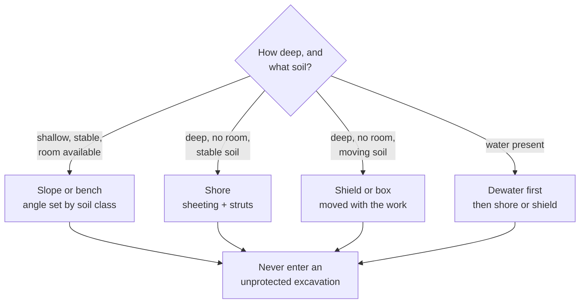
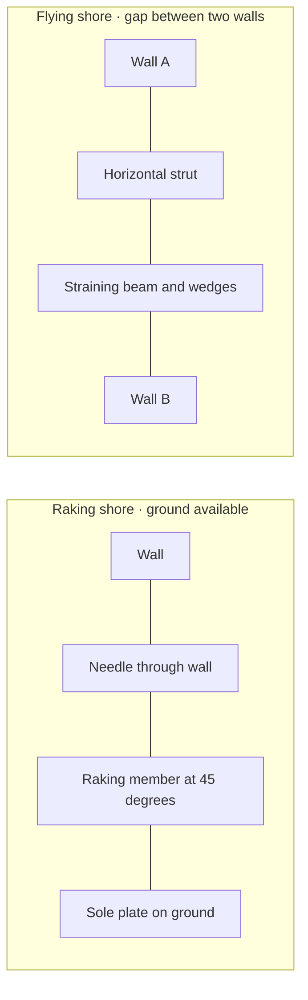
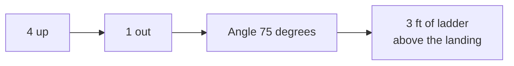
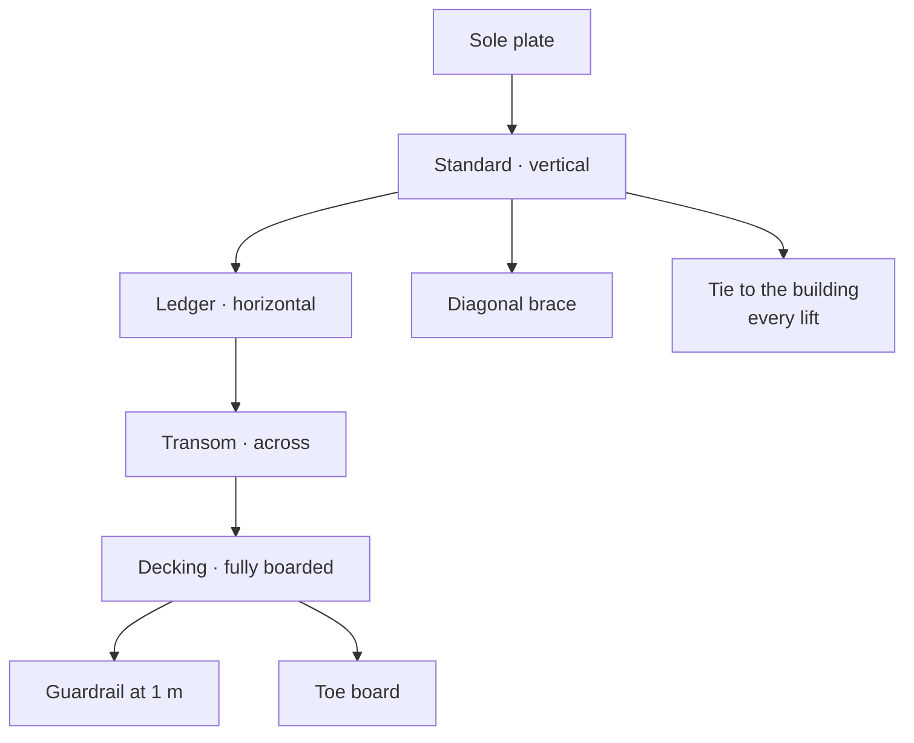
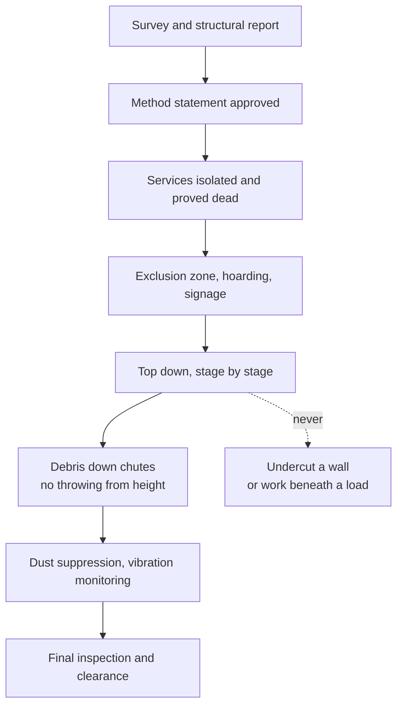
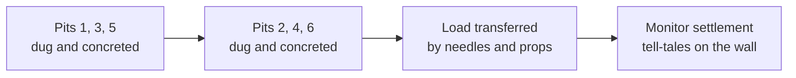
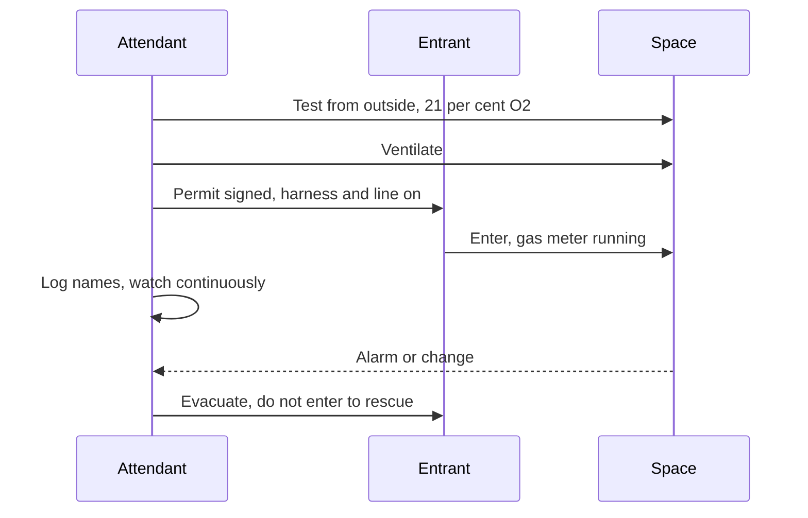
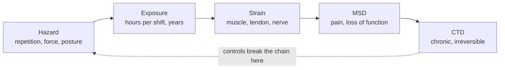
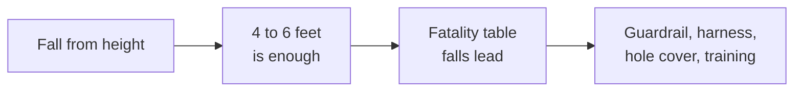

# Module 3 — Introduction to the Construction Industry and Safety

**20MCN401 Industrial Safety Engineering · B.Tech CSE, Sem 7 (Saintgits, autonomous) · Module III of V, 20% ESE, CO3.** Sources: `m3.txt` (`slide N`), read against `syllabus.md` and `question_map.md`. **Read this first:** the deck is a 26 MB PowerPoint that yields only 17 000 characters of text, because about 60 of its 115 slides are photographs with no text layer. Slides 27–30, 34–50, 61–66, 69–71, 74–77, 79–86, 90–108 and 112 are blank in the extract. Worse, `slide 115` — the whole National Building Code bullet — reads `(to be Included………………)`. So this module is mostly deck-followed, with three large gaps filled from the standard and marked **(standard)**: scaffolds (§2.7), tunnelling (§2.8) and the entire NBC and Indian Standards block (§2.12). Values marked **(standard)** appear in no slide, and you should be able to defend them as code values rather than invent precision.

---

## 1. Coverage

### 1.1 Syllabus line → section

| Syllabus line (verbatim) | Hrs | Answered at |
|---|---|---|
| Excavation and filling — under-water works — underpinning — shoring | 3 | §2.2, §2.3, §2.4, §2.5 |
| Ladders — scaffolds — tunnelling | 3 | §2.6, §2.7, §2.8 |
| Blasting — demolition — confined space | 3 | §2.9, §2.10, §2.11 |
| Indian Standards and National Building Code provisions on construction safety | 3 | §2.12 |
| Relevance of ergonomics in construction safety | 3 | §2.13 |
| Ergonomics hazards | 3 | §2.14 |
| Musculoskeletal disorders — cumulative trauma disorders | 3 | §2.15 |

The construction-hazard overview that frames all seven lines sits in §2.1. It answers Q13 and gives every other answer its opener.

Read the module in two passes. The first pass is §2.1 to §2.5, which is the ground: the hazard profile, then the earthworks block the syllabus writes as one line. The second pass is §2.6 to §2.11, which is the plant and the processes: ladders, scaffolds, tunnels, explosives, demolition, and the spaces you enter. §2.12 is the legal block and is the one place where you must be more careful than the deck, because the deck has nothing. §2.13 to §2.15 are ergonomics, and they are the most reliably asked eight marks in the module.

The exam shape follows the hours. Seven syllabus lines at three hours each means the paper can afford one question per line, and it usually takes a 3-mark definition from one line, a 5-mark list from another, and an 8-mark or 14-mark construct from a third. Two patterns recur across the question bank. The first is the **definition pair** — underpinning and shoring, asked four separate times in slightly different words (Q82, Q83, Q154, and inside Q155). The second is the **scenario**, where the question hands you a job title and a site and asks what you would do (Q80, Q156, Q157). A scenario is marked like a method statement, not like an essay, and §3.5 and §3.6 shows the shape.

Three things decide where the marks sit in this module. The first is **the verb**. "Define" wants a definition and one example, and nothing else. "Explain" wants a mechanism, in order. "Discuss" and "comment" want a position taken and then defended. "You are appointed as" wants a method statement with headings. The second is **the number of items**, because the paper almost always tells you: six practices, five causes, three stages. Count them on your fingers before you start writing, and number them on the paper. The third is **the construct**, because shoring, underpinning, tunnelling and blasting are the four topics the examiner can push on for a second question. A candidate who can explain how a raking shore carries load, or why underpinning is done in alternate bays, is not at risk in this module.

Use §4 as the revision surface and §5 as the drawing practice. §4 exists because this module is unusually number-heavy: ladder angles, trench depths, guardrail heights, gas limits and cordon distances. Most of those numbers are in the deck, and the ones that are not are marked clearly. §5 lists eleven figures, and five of them are worth being able to draw in ninety seconds, because a labelled sketch earns marks faster than a paragraph and cannot be marked wrong for style.

### 1.2 All 31 assigned questions

| Q | Question (short) | Marks | Answered at |
|---|---|---|---|
| Q13 | Hazards at different stages of building construction | 8 | §3.3 A |
| Q14 | Define shoring | 3 | §3.1 A |
| Q15 | Six ladder safety practices | 3 | §3.1 B |
| Q17 | Six practices for working at heights | 3 | §3.1 C |
| Q18 | Six precautions before blasting | 3 | §3.1 D |
| Q38 | NBC classification of residential buildings | 5 | §3.2 A |
| Q39 | Why ergonomics is important | 3 | §3.1 E |
| Q40 | Causes of ergonomic hazards in construction | 5 | §3.2 B |
| Q41 | Relevance of ergonomics in construction safety | 8 | §3.3 B |
| Q43 | NBC guidelines on building exits | 8 | §3.3 C |
| Q44 | Why the NBC guidelines must be followed | 3 | §3.1 F |
| Q78 | Safety practices in excavation work | 8 | §3.3 D |
| Q79 | Safety measures in demolition | 8 | §3.3 E |
| Q80 | Safety manager, 10-storey demolition, congested area | 14 | §3.4 |
| Q82 | Underpinning and shoring defined; underpinning precautions | 8 | §3.3 F |
| Q83 | Underpinning and shoring defined; shoring precautions | 8 | §3.3 G |
| Q101 | Ergonomic risk factors lead to MSD — comment | 5 | §3.2 C |
| Q102 | Construction safety provisions in the NBC | 8 | §3.3 H |
| Q103 | Major ergonomic hazards in construction | 8 | §3.3 I |
| Q104 | Short note on cumulative trauma disorders | 5 | §3.2 D |
| Q107 | High-rise safety and fire protection per NBC | 8 | §3.3 J |
| Q108 | Important provisions of the NBC | 8 | §3.3 K |
| Q125 | (a) PPE against chemical hazards (3) (b) MSDS (4) | 7 | §3.1 G · §3.2 E |
| Q152 | Ergonomic risk factors and practical controls | 8 | §3.3 L |
| Q153 | Hazards to check before underwater or excavation work | 5 | §3.2 F |
| Q154 | Underpinning and shoring; underpinning precautions | 8 | §3.3 F |
| Q155 | Ladder and scaffold hazards and prevention | 8 | §3.3 M |
| Q156 | Blasting planned in a densely populated area | 8 | §3.3 N |
| Q157 | Blasting near a protected wildlife area | 5 | §3.2 G |
| Q158 | NBC general safety requirements for construction | 8 | §3.3 O |
| Q159 | Early signs and symptoms of MSD and CTD | 5 | §3.2 H |

Q82 and Q154 are the same question, and Q83 is its mirror. One prepared answer in §3.3 E serves both, and the shoring precautions sit behind it in §3.3 F. Q125 is a Module V question that the paper set on this module — answer it short here and do not let it eat the time for the NBC question.

**Not this module, though the wording looks close:** confined-space entry procedure and permits (§ Module II); lifting and carrying technique (§ Module IV); fire extinguisher selection (§ Module V); HAZOP and PHA (§ Module V). Module III owns confined spaces *on a construction site*, and it owns ergonomics as a construction problem, not as an office problem.

---

## 2. Concepts

### 2.1 The construction hazard profile, stage by stage

*In plain English.* A building site is a factory that is rebuilt every week. The walls move, the floor is sometimes a hole, and the crew changes with the phase. That is why the hazard changes as the job goes up. A worker who is safe on the ground floor may be the one who dies on the roof.

*The detail.* The deck opens with four hazard families and treats them as the whole story (`slide 2`):

- **Falls** — from height, into holes, off edges.
- **Electrocution** — temporary supplies, overhead lines, portable tools, water.
- **Struck by falling objects** — materials, tools, plant, structural steel.
- **Trapped during excavation** — cave-in, burial, crushing.

Falls are **the leading cause of fatalities in construction** (`slide 5`). A fall from as little as **4–6 feet** can cause lost work or death (`slide 5`). That single line explains why the deck spends three sections on fall protection before it mentions anything else.

| Stage | Dominant hazards | One control |
|---|---|---|
| Site clearance, demolition of old stock | Dust and asbestos, falling structure, plant movement | Survey first, exclusion zone, wet suppression |
| Excavation and foundation | Cave-in, buried services, water, falls into the hole | Sloping or shoring, service scan, edge protection |
| Piling | Noise, vibration, rigging, suspended load, bore collapse | Designed rig platform, exclusion radius, banksman |
| Structural frame and RCC | Formwork collapse, rebar impalement, falls, crane load | Designed formwork, rebar caps, decks and nets |
| Masonry and blockwork | Falls, block weight, silica dust from cutting | Guardrails, mechanical lifting, wet cutting |
| Roofing and waterproofing | Fragile roof, fall through openings, hot bitumen | Crawl boards, covers, hot work permit |
| Services and MEP | Electrical contact, confined space, hot work | Isolation, permit, gas test |
| Finishing | Solvent vapour, dust, awkward posture, ladders | Ventilation, low-VOC paint, platform not ladder |
| Handover and testing | Energisation, pressure test, last-minute access | Lock-out, test plan, no lone working |

*What to write (8 marks).* Five stages, two hazards per stage, one control per stage. A table is faster than prose and easier to mark. Open with the four families and the falls-first fact, close with the sentence that the hazard follows the phase.

**Mark anchor.** Falls lead the fatality table; a fall from **4–6 feet** is enough. Quote both and you have shown you read the deck rather than a blog. If you have room, add the third fact: cave-in is the greatest excavation risk, and most of those accidents happen between five and fifteen feet. Three facts, three stages of the answer.

**Exam trap.** "Different stages" means the **construction sequence**, not the four hazard types. A candidate who writes falls / electrocution / struck-by / trapped has answered a different question, however correct the list.

The four families are a useful opener and a poor answer, because they describe **what hurt** rather than **when it was possible**. A site with no excavation has no cave-in risk, and a finished frame has no more formwork to fall off. That is why the stages matter: each one brings its own plant, its own access and its own unfinished edges. The deck's own picture slides sit exactly where this detail should be — `slide 3` and `slide 27`–`slide 30` carry photographs of the four families and nothing else.

### 2.2 Excavation and filling

*In plain English.* An excavation is a hole whose walls were never designed to stand up. The soil is holding itself together out of habit, and it stops doing that without warning. Most of the people killed in trenches are killed by a wall they were standing next to a minute earlier.

*The detail.* The deck is blunt about the ranking (`slide 15`):

- Excavation is **the most hazardous construction operation**.
- **Cave-in is the greatest risk**, not falls or plant.
- **Most accidents happen in trenches 5–15 ft deep** — deep enough to bury a person, shallow enough that nobody bothers to shore it.
- Employees must be protected by a **well-designed protective system** sized for the expected loads (`slide 16`).

**Four ways to hold the ground** (`slide 18`, `slide 26`):

| System | What it does | When it is chosen |
|---|---|---|
| **Sloping** | Cuts the wall back to a stable angle | Open site with room either side |
| **Benching** | Cuts the wall into steps | Cohesive soil, medium depth |
| **Shoring** | Pushes sheeting against the wall with struts | Tight site, services close by |
| **Shielding** | Puts a box between the wall and the worker | Any soil, where a crew must work in the trench |

Soil type sets the slope **(standard)**: about **0.75 : 1** for hard cohesive ground, **1 : 1** for firm soil, **1.5 : 1** for loose or water-bearing ground. The deck's own hazard list for the design is: **soil classification, depth of cut, water content, weather change, and other operations nearby** (`slide 20`).

- The **competent person** must be trained in soil classification, protective systems and the standard. That person must be able to identify a hazard and must be **authorised to stop work on the spot** (`slide 24`).
- Inspection is **daily**, before work starts, after rainstorms or high wind, and whenever a hazard is expected (`slide 25`).
- **Access and egress:** a stairway, ladder or ramp is needed at **4 ft or deeper**, within **25 ft** of every worker, and it must stand **3 ft above** the excavation edge (`slide 23`).
- Spoil, plant and materials stay back from the edge — about **0.6 m** minimum **(standard)**.
- Other excavation hazards named by the deck (`slide 26`): **water accumulation, oxygen deficiency, toxic fumes, falls, and mobile equipment**.

**Filling and backfill** is the second half of the syllabus line and the deck ignores it. The hazards are real:

- Side-dumping soil into a trench instead of placing it in layers can **collapse the shoring** and damage services.
- Compact in layers of about **150–200 mm** **(standard)**, at the right moisture content, or the fill settles and the slab cracks.
- Plant working at the edge of a filled trench re-loads the wall. Keep the excavator back.
- Backfill against a new wall before it has cured, or before the props are struck in sequence, pushes the wall over.
- Fill over a service without a marker or a drawpit is a future excavation strike.

*What to write (8 marks).* Ranking first (cave-in, 5–15 ft). Then the four protective systems with one line each, and the competent person with the daily inspection rule. Finish on the 4 ft / 25 ft / 3 ft egress numbers and the "other hazards" list. Draw the four system sketches if there is room — they earn marks faster than prose.

**Mark anchor.** **5–15 ft** and **daily inspection by a competent person**. Those two facts separate a candidate who knows the module from one who knows that trenches collapse.

**Exam trap.** **Shoring and shielding are not the same.** A shield does not stop the wall moving; it survives the movement and protects whoever is inside it. A candidate who writes "trench box shores the sides" has lost the distinction the examiner is testing.

### 2.3 Under-water works

*In plain English.* Working below water level means two things are trying to get into your workplace: the water, and your own body's nitrogen. One drowns you quickly, the other makes you ill on the way up. The deck has no slide on this topic at all, so treat every line here as **(standard)**.

*The detail.* Three families, and they fail differently:

| Family | What it is | Signature hazard |
|---|---|---|
| **Open-water diving** | A diver works in the water itself | Drowning, entanglement, decompression sickness |
| **Cofferdam or dewatered work** | A watertight enclosure pumped dry | Sudden flooding, wall collapse under differential pressure |
| **Compressed-air caisson** | A sealed working chamber held above atmospheric pressure | Decompression sickness, air lock failure, fire |

- **Decompression sickness** ("the bends") happens when dissolved nitrogen forms bubbles as pressure drops too fast on the way up. It causes joint pain, dizziness, paralysis and can kill. Plain gloss: the gas that was dissolved in your blood comes out of solution inside your body.
- The controls are **staged ascent to a decompression table** and a **decompression chamber on site**. A chamber off site is a chamber too late.
- Other diver hazards: **barotrauma** (pressure injury to ear or lung), hypothermia, poor visibility, current, entanglement in lines or debris, contaminated water, boat traffic, loss of communication.
- Cofferdam hazards: **flooding through a seal failure, sheet pile collapse, differential water pressure on the wall, drowning at the access ladder, and pumping out faster than the ground can take it**.
- Caisson hazards: pressure, air lock discipline, blowout of the working face, fire in the compressed atmosphere, and the bends on exit.

**Precautions that earn marks:**

- A **diving supervisor** in charge, a **standby diver** suited and ready, and a **diver's log** for every descent.
- Medical fitness to dive, current certification, and a **permit to work** for each dive.
- **Life line and communication** to the surface; **surface marker buoy and flag**; an exclusion zone for plant and boats.
- **Oxygen and resuscitation equipment** at the surface, and a trained first-aider.
- Tide and current checked before entry; no diving in poor visibility or high flow.
- Contaminated water: full face mask or a dry suit, and vaccination where sewage is present.
- Cofferdam: designed by an engineer for the hydrostatic head (the water pressure pushing on the wall), sealed joints, **standby pumps**, an escape ladder inside, and a watchman at the top.
- Caisson: **air lock operated by a trained lock attendant**, decompression staged by table, no alcohol, medicals, and fire watch inside.

*What to write (5 marks).* Name the three families, then give diving hazards and controls, then close with the cofferdam flooding risk. Two lines on the bends and the on-site chamber is the mark-earning pair.

**Mark anchor.** **Decompression sickness plus an on-site decompression chamber.** That pairing proves you understand pressure physiology and not just "water is dangerous".

Two administrative controls carry more weight here than any item of equipment. The first is the **permit to work**, because a dive or a cofferdam entry has a start, a depth, a duration and an end, and the permit is where those are agreed. The second is the **standby**, which on a dive is a suited diver at the surface and on a cofferdam is a watchman at the top of the ladder. Neither can help if nobody is watching.

**Exam trap.** "Underwater" does not mean "wet". A **dewatered cofferdam** is an underwater work whose hazard is **flooding and structural collapse**, not drowning mid-dive. Candidates who write only about divers miss half the marks.

### 2.4 Underpinning

*In plain English.* Underpinning is putting a new foot under an old building while the building keeps standing. You dig under a wall that is already carrying a house, pour concrete, and hope the wall does not notice. Everything in the method exists to make sure it never notices.

*The detail.* **Definition:** underpinning is the process of strengthening or deepening the foundation of an existing structure, by introducing new permanent support below the existing level (`slide 115` carries nothing; the deck has no underpinning slide, so **(standard)**).

**Five triggers:**

1. **Differential settlement** — the building is cracking and the cause is the ground.
2. **A deeper excavation next door** — a basement or a metro cut removes the support the old footing was relying on.
3. **Change of use or added storeys** — the load went up and the footing did not.
4. **Deterioration** — the original footing was timber, or sulphate attack has eaten the concrete.
5. **Raising a basement** — the floor level goes down and the footing must follow.

**Methods, one line each:**

| Method | How it works |
|---|---|
| **Pit underpinning** | Dig small pits under the wall in alternate bays, fill with mass concrete, then do the bays in between |
| **Needle and pile** | A needle beam passes through the wall and carries it on piles either side |
| **Mini-piling** | Small-diameter bored piles installed from a low headroom rig |
| **Jet or chemical grouting** | Inject grout to bind loose ground under the footing |
| **Soil freezing** | Freeze the pore water until the ground is strong enough to dig |
| **Screw piles** | Power-installed piles with no excavation and no vibration |

**Precautions — this is what the question pays for:**

- **Design first.** A structural engineer designs the sequence, the section sizes and the props. The drawing stays on site.
- **Work in alternate bays**, never a continuous open trench along the wall.
- Keep each open length to about **1.2–1.5 m**, and never have **more than about a quarter of the wall length open at one time** **(standard)**.
- **Shore or prop the structure above** before you take the ground away. Load must be carried continuously, never suspended.
- **Never leave a pit open overnight** without a cover, a prop and a barrier.
- **Monitor**: tell-tales, settlement markers and crack gauges on the building and on its neighbours, read daily and recorded.
- **Check the neighbours.** Party walls, adjoining footings and shared drains are affected by your digging, and are usually the first thing to crack.
- **Control water.** Dewatering draws down the water table and causes settlement a street away. Monitor and recharge if needed.
- **Backfill and compact in layers**, and do not strike the props until the new work has gained strength.
- **No vibration and no heavy plant** close to the open face.
- **Competent supervision** at all times, and one person with authority to stop the work.

*What to write (8 marks).* Definition, three triggers, two methods named and explained, then six precautions in the order above. Finish with the monitoring line — it is the one precaution that distinguishes an engineer's answer.

**Mark anchor.** **Alternate bays, 1.2–1.5 m sections, never more than a quarter of the wall open.** Three numbers that prove you know how underpinning is actually sequenced.

**Exam trap.** **Underpinning is permanent and load-bearing; shoring is temporary.** If your answer says "underpinning is a temporary support", you have defined the other word and the rest of the answer cannot recover.

### 2.5 Shoring

*In plain English.* Shoring is a prop with a job description. It holds up something already standing — a wall, a floor, the side of a trench — until the permanent support exists or the work is finished. Take the prop away too early and the thing it was holding comes down on schedule.

*The detail.* **Definition:** shoring is the provision of temporary support to an existing structure, or to the sides of an excavation, to prevent collapse or movement (`slide 31`; **(standard)** for the structural forms).

**Two families:**

| Family | Purpose | Members |
|---|---|---|
| **Structural shoring** (dead shoring) | Holds up a building while work goes on below | Raking shore, flying shore, dead shore, needle and prop |
| **Excavation shoring** | Holds the sides of a trench or basement | Sheeting, walers, struts, hydraulic braces |

**The forms you should be able to name and sketch:**

- **Raking shore** — raking members lean against the wall at about 45°, footed on a sole plate on firm ground, with needles through the wall and cleats at the head. Used when there is ground beside the building to foot on.
- **Flying shore** — a horizontal strut spanning between two buildings across a gap or a road, with straining beams and wedges at each end. Used when there is **no** ground to rake against.
- **Dead shore** — vertical posts carrying a wall above an opening down to a new foundation, with needles through the wall.
- **Needle and prop** — a beam through the wall, carried on props or on a frame, transferring the load away from the work.

**Precautions — the deck gives these on `slide 32` and `slide 33`, and they are worth quoting:**

- A **qualified person surveys the site** for anything that could affect the shoring, and corrects it before erection.
- **Plan the installation in advance**, including the equipment needed to finish safely.
- **Inspect every component before use**; remove and repair anything defective, and never use it.
- Keep a **shoring drawing from a qualified professional on site at all times**.
- Handle the equipment as designed; **do not erect, dismantle or alter it without a qualified supervisor's approval**.
- **Inspect the system through the life of the project.** If there is any doubt, **stop work** and call the supervisor.
- **Shoring is not fall protection** (`slide 33`). A shoring frame is not an anchor and not a platform.
- **Do not climb on the cross braces.**
- Correct uneven ground; **plumb and level the frames as erection proceeds**; do not force braces to fit.
- On dismantling, **nothing is removed until a supervisor approves**.

Add the numbers and the practice **(standard)**: sole plates under every leg, wedges rather than packing, struts at close spacing in soft ground, and monitoring of the wall or the trench edge while the shoring is loaded.

*What to write (8 marks).* Definition, the two families in a small table, raking versus flying with the "is there ground to foot on" test, then the deck's precautions as a numbered list. Close with "shoring is temporary and is never used as an anchor".

**Mark anchor.** **Raking shore when there is ground beside the wall; flying shore when there is a road or a gap.** That single decision line shows you can choose a shore rather than recite one.

**Exam trap.** The deck states in plain words that **shoring systems must not be used for fall protection**. That is a free mark, and it is the exact line most candidates skip.

### 2.6 Ladders

*In plain English.* A ladder is a tool for reaching a place, not a place to work from. The moment you take both hands off to pull a cable, you are standing on a slope with nothing holding you. That is why the rules are so fussy about angle, tie-off and three points of contact.

*The detail.* The deck leads with the cost (`slide 51`):

- **Falls from ladders are about 20 per cent of fatal and lost-workday injuries** in general industry, by OSHA's estimate (`slide 51`).
- A ladder is chosen first: **what height must I reach, what must I check, what material is right** (`slide 52`).
- Inspection before every use: **label legible, non-slip feet, no defects, no slipping hazard** (`slide 53`).
- **Step ladders** (A-frame) must be **fully extended with the arms locked**, and pinch points are the joints (`slide 54`). **Never use a step ladder as an extension ladder.**
- **Extension ladders** need non-slip bases or spikes, and must be placed so they cannot slide (`slide 55`).
- The angle rule: **base 1 foot out for every 4 feet up**, which is about **75°**, and the ladder must **extend 3 feet above the roofline** (`slide 55`).
- The **belt-buckle rule**: keep your body centred between the rails (`slide 56`).
- **Never step above the labelled maximum height.** Face the ladder, and keep **three points of contact** going up and down (`slide 56`).
- Base on **firm, level footing**; level the ladder rather than packing one leg (`slide 57`).
- **Tie, block or otherwise secure** the ladder so it cannot slip. Stabilisers are acceptable (`slide 57`).
- Keep ladders out of doorways and traffic routes (`slide 57`).
- **Never leave a ladder unattended**, never **tie two ladders together** or stack one on anything but the ground, and **engage every lock** (`slide 58`).
- **Never climb carrying tools or material** — hoist them (`slide 58`).

Add two **(standard)** rules: only one person on a ladder at a time, and never work from the top three rungs of a straight ladder.

**The four ladder types, and where each one is wrong:**

| Type | Use | Never |
|---|---|---|
| **Step ladder (A-frame)** | Short work at a fixed spot | Used partly open, or as an extension ladder |
| **Extension ladder** | Access to a roof or a higher level | Raised while someone is on it, or spliced to another |
| **Trestle and platform ladder** | Short duration work needing both hands | Overloaded, or set on a slope without levelling |
| **Fixed or cage ladder** | Permanent access to a plant room or roof | Used without the cage or the fall arrest where the code requires one |

Two more points earn marks and are easy to forget. A ladder is a **means of access**, so it must be long enough to land safely and must not be the place where the work is actually done — a platform is. And a fall from a ladder is not over when the body stops: a worker left suspended in a harness can lose consciousness in minutes, so the rescue plan matters as much as the tie-off.

*What to write (3 or 8 marks).* For 3: six rules, one line each — angle, tie-off, three points, no overreach, inspection, no carrying loads. For 8: add the 20 per cent figure and the choice-and-inspection sequence at the front.

**Mark anchor.** **1 in 4, about 75°, and 3 feet above the landing.** Three numbers that carry the whole answer.

**Exam trap.** The **3 feet is above the landing**, not the total length, and it is measured on an **extension ladder**, not a step ladder. Writing "the ladder should be 3 feet taller than the roof" is a different and wrong statement.

### 2.7 Scaffolds

*In plain English.* A scaffold is a temporary building made of steel tubes whose only job is not to move. It is designed, erected, loaded and inspected like a structure, because that is what it is. Most scaffold deaths come from a platform that was never finished, never tied to the building, or loaded with more blocks than it was designed for.

*The detail.* The deck mentions scaffolds once, inside the fall-protection list (`slide 6`), and gives no dimensions. Everything below is **(standard)**.

**Types:**

| Type | Description |
|---|---|
| **Putlog scaffold** | Inner end of the putlog sits in a hole in the wall — only for masonry, and illegal for most modern work |
| **Independent or tied scaffold** | Two rows of standards, tied back to the structure — the normal site scaffold |
| **Mobile tower** | Wheeled frame, moved by hand, never occupied while moving |
| **Cantilever or bracket scaffold** | Projecting from the structure where the ground is not available |
| **Suspended scaffold (swing stage)** | Hung from roof rigging on wire ropes, for facade work |

**Members you must be able to label:** **standards** (verticals), **ledgers** (horizontal along the face), **transoms** (across the width), **braces** (diagonal, for stability), **sole plates** and **base plates** (load spread), **ties** (to the building), **guardrails**, **toeboards**, and the **working platform**.

**Dimensions and rules** **(standard)**:

- Standards spaced no more than about **2.0 m** apart, with lifts no higher than **2.0 m**.
- Platform at least **600 mm** wide for persons, and wider where material is stacked.
- **Top guardrail 39–45 in (about 1.0 m)** and a mid-rail at half height, with **toeboards at least 3 in** — the deck's fall-protection numbers (`slide 9`) and the usual code value **(standard)**.
- **Ties at every lift and at every alternate bay**, and more where the scaffold is sheeted.
- **Sheeting or netting needs a design check** for wind; a sheeting panel turns a scaffold into a sail.
- Duty rating stated and respected: light, medium or heavy, in **kN/m²**.
- **Erected, altered and dismantled only by trained scaffolders**, under a supervisor.
- **Inspected before first use**, then at intervals of no more than **7 days**, and **after any alteration, impact or high wind**. Tagged green or red.
- **Access by an internal ladder**, never by climbing the braces.
- **Never partially dismantle** a scaffold that is still in use, and never remove a tie to get a delivery through.
- Fall protection on the platform: guardrail first, harness only where guardrail is impossible.

*What to write (8 marks).* Type table, member names on a sketch, four dimensions, then inspection and tagging. A labelled elevation sketch in the middle of the answer is worth more than two extra paragraphs.

**Mark anchor.** **Guardrail 39–45 in, toeboard 3 in, ties every lift at alternate bays, inspection every 7 days.** Four specifications that show you have seen a scaffold tag.

**Loading is where scaffolds fail quietly.** A duty rating is a limit on the uniformly distributed load, and a pallet of blocks is a point load. The two are not the same, and a platform rated light will carry a stack of blocks in the middle without complaint until it does not. State the duty, spread the material, and clear the platform at the end of the shift.

**Exam trap.** "New scaffold, so it is safe" is wrong. The scaffold must be **inspected before first use and re-inspected after alteration**, because the dangerous scaffold is usually the one that was safe yesterday and had a tie removed this morning.

### 2.8 Tunnelling

*In plain English.* A tunnel is a cave that you build on purpose, and the ground's only ambition is to close it again. So a tunnel job is three jobs at once: hold the ground up, keep the water out, and keep the air breathable. The deck has a section heading and nine blank slides here (`slide 59`–`slide 66`), so this is all **(standard)**.

*The detail.* **Hazards:**

- **Fall of ground** — roof or face collapse, spalling, rock burst in hard rock.
- **Water inrush** — a sudden flood from a fault, a fissure or an old borehole. This is the fastest killer in tunnelling.
- **Gases** — methane, hydrogen sulphide, carbon monoxide from plant, and **oxygen deficiency**. Sewer and metro tunnels hit all four.
- **Dust** — respirable silica from drilling and cutting.
- **Fire** — plant diesel, conveyor belting, hydraulic fluid, and timber.
- **Plant and transport** — locomotives, TBM, muck skips, and men walking in the same narrow space.
- **Compressed-air working** — decompression sickness where a face is pressurised.
- **Physical environment** — heat, humidity, noise, vibration, poor lighting, restricted egress.
- **Explosives** — in drill-and-blast headings.

**Precautions:**

- **Investigate the ground before you cut it.** Boreholes and a geological model along the alignment; **probe drilling ahead of the face** in unknown ground.
- **Design the support and install it with the excavation**, not after it. Ribs, lattice girders, rock bolts, mesh, shotcrete or segmental lining, plus **forepoling** where the crown is weak.
- **Control the water** — grout ahead of the face in water-bearing strata, and dewatering with **standby pumps and a standby power supply**.
- **Ventilate mechanically.** Forced air to the face, sized to hold **oxygen at or above 19.5 per cent** and to dilute fumes and dust **(standard)**.
- **Monitor gas continuously** at the face and at the return, with automatic alarm and **flameproof electrical equipment** in gassy ground.
- **Two independent ways out**, maintained and lit, with an escape route marked and a muster point.
- **Refuge chambers or safe havens** in long headings, with air, water and communication.
- **Communication** from face to surface at all times — telephone, radio or a leaky feeder.
- **Trained rescue team** and self-rescuers issued to everyone underground.
- **Compressed air**: air locks with a trained lock attendant, staged decompression by table, medicals, and a chamber.
- **No hot work without a permit**, and a fire point with extinguishers and a water main at the face.
- **Survey control** for alignment, and a **shotcrete and scaling regime** to take down loose rock before anyone works under it.

*What to write (8 marks).* Three groups — ground, water, air — with three precautions each, plus the emergency arrangements. That structure answers the question even if the examiner wanted a different list, because it is exhaustive by construction.

**Mark anchor.** **Probe ahead, support with the cut, ventilate and monitor gas.** Those four verbs are the whole discipline of tunnelling safety.

**Two ways to cut a tunnel change the hazard list.** In drill and blast, the hazards are the explosive, the fumes and the scaling of the newly broken rock. With a tunnel boring machine, the hazards are the machine itself, the segment erector, dust, noise and heat, and the shield that holds the ground while the lining goes in. Say which method you are describing, because the precautions are not interchangeable.

**Exam trap.** Candidates write collapse and stop. In soft ground, **water inrush and gas** kill more crews than roof fall does, and an answer with no ventilation line looks like it was learned from a mining poster.

### 2.9 Blasting

*In plain English.* Blasting turns rock into gravel with a controlled explosion. The rock is not the problem. The problem is all the energy that leaves the hole instead — through the ground, through the air, and through the sky as flying stone. Almost every blasting precaution is about where that leftover energy goes.

*The detail.* **Definition and sequence (deck, `slide 67`):** blasting is the reduction of rock or hard soil into fragments with the help of explosives. The operation has four steps — **drill the holes, install the detonator and charge, detonate, remove the debris**.

**The five escape routes for energy, and the control for each:**

| What escapes | What it does | Control |
|---|---|---|
| **Ground vibration** | Cracks plaster and foundations nearby | Charge per delay, millisecond delays, monitoring |
| **Airblast** | Broken windows, startled livestock, complaints | Stemming length, matting, face orientation |
| **Flyrock** | Kills at a distance | Correct burden, stemming, blasting mats, danger radius |
| **Fumes** | Carbon monoxide and nitrogen oxides in the pit | Ventilate, wait, never re-enter on the wind |
| **Misfire** | An unexploded charge found by the next shift | Written procedure, waiting time, no re-drilling |

**Precautions before firing** — the standard set **(standard)**. The deck's own slides 68–71 are pictures.

1. **Only a licensed blaster in charge**, under a **permit to work**, with a written blast design for the pattern, the charge and the delay sequence.
2. **Survey the surroundings** — structures, services, roads, wells, livestock, and the nearest neighbour, with a condition survey before the first blast.
3. **Clear the area to the designed danger radius**, in practice **200–500 m** in open rock, with **sentries at every approach** and barriers on the roads.
4. **Warning signals** agreed and audible: a warning, a countdown, the firing signal, and an **all-clear**. Red flags by day, red lights by night.
5. **Shelter** everyone, including the machine operators, behind cover or out of the radius.
6. **Store and issue properly** — licensed magazine, **detonators in a separate store**, issued by a storekeeper and signed for.
7. **No flame, no smoking, no mobile phone or radio** near electric detonators, because radio frequency energy can fire them.
8. **Load with non-sparking tools** — wooden or plastic tamping rods, no iron, no force.
9. **No charging in a thunderstorm**, and earth the firing circuit.
10. **Check the burden** before firing; a hole with too little rock in front of it throws its energy sideways as flyrock.
11. **Use blasting mats** over the holes in built-up areas.
12. **Guard against vibration** — limit the charge per delay, use delays, and keep **peak particle velocity at about 5 mm/s at the nearest residential structure** **(standard)**.

**After the blast** (`slide 67`, step four): wait for the fumes, inspect for **misfires**, scale down loose rock, and remove debris only when the blaster declares the face safe. On a misfire, **nobody approaches until the waiting time has passed** — 30 minutes with safety fuse, 5 minutes with electric firing, as a working rule **(standard)**. Never re-drill a misfire hole, never pull a detonator lead, and never assume a charge failed because the bang was quiet.

*What to write (3 or 8 marks).* For 3: six precautions — licensed blaster and permit, clear the radius with sentries, warning signals, correct stemming and mats, no flame or radio near detonators, post-blast inspection for misfires. For 8: add the energy table and the vibration limit.

**Mark anchor.** The **four-step sequence** plus **"clear the radius, sentries at every approach, all-clear only from the blaster"**. That is the sentence the examiner is looking for.

**Exam trap.** Q18 says **before** the operation. Survey, permit, warning, shelter and stemming all belong before; **misfire inspection and scaling** belong after. An answer that opens with "inspect for misfires" has answered the wrong half and lost the ordering marks.

### 2.10 Demolition

*In plain English.* Demolition is construction in reverse, with two differences. The structure is already weak, and nobody can fully trust the drawings of it. So the work is planned from a survey, done from the top down, and kept away from people who are not in the business of being there.

*The detail.* **Definition (deck, `slide 72`):** demolition or dismantling means breaking up buildings or structures, either fully or partially.

**Three goals of every demolition precaution (`slide 72`), and quote them in this order:**

1. **Safeguard the personnel on the site.**
2. **Safeguard persons not connected with the demolition**, including the general public.
3. **Protect property likely to be affected** by the operation.

**Causes of demolition accidents, straight from the deck (`slide 72`):**

- **Falls from height.**
- **Falling materials.**
- **Inadequate access.**
- **Over-fragile materials** — the structure is weaker than assumed.
- **Premature collapse** from incorrect dismantling, overloading, or excessive pre-weakening.

That last group is the one to learn as a phrase. "Premature collapse due to incorrect dismantling" is the definition of almost every demolition fatality.

**Methods:**

| Method | Note |
|---|---|
| **Top-down or progressive** | Element by element from the roof down; the default for buildings near other buildings |
| **Mechanical** | Pusher arm, grapple, or ball and crane; needs a bigger exclusion zone than people expect |
| **Deliberate collapse** | Cutting the structure so it falls in a chosen direction; used only in open ground |
| **Explosive (implosion)** | Charges on columns and core, sequenced to drop the building into its own footprint |

**Precautions:**

- **Structural survey first**, plus drawings of the original and of every alteration. Assume the drawings are wrong and verify.
- **Disconnect and isolate the services** — electricity, gas, water, drainage — and prove the isolation. Seal the drains.
- **Asbestos survey and removal before anything else.** Asbestos in a demolition is the classic hidden killer.
- **Exclusion zone**: a hoarding, and a cordon of at least **one and a half times the building height** **(standard)**, with gates, guards and warning signs.
- **Plan the sequence** so no element is left unsupported: remove from the top, never undercut, and never load a floor with debris beyond its design load.
- **Debris down chutes**, not thrown from height, and skips positioned inside the cordon.
- **Dust suppression** with water sprays, and respiratory protection for silica.
- **Protect the neighbours**: condition survey of adjoining buildings, tell-tales on party walls, and monitoring for movement.
- **Access** by proper stairs or scaffold, not by climbing debris.
- **Trained, competent operatives** and a **banksman** for every machine.
- **No burning of waste on site**, and a **fire plan** with water and extinguishers.
- **Emergency plan** with a rescue route, first aid, and a means of accounting for everyone.

*What to write (8 marks).* Definition and three goals, the accident-cause list, two methods, then six precautions in a numbered list. Close with the sequence rule — top down, never undercut — because that is the engineering content of the answer.

**Mark anchor.** The **three goals** verbatim, and **"premature collapse from incorrect dismantling or overloading"**. Both are on the slide and both are quotable.

**Exam trap.** Demolition is not a synonym for explosives. Most demolition in a city is **top-down mechanical**, and an answer that goes straight to implosion has skipped the method that the examiner's own city uses.

### 2.11 Confined space in construction

*In plain English.* A confined space is a place with one way in, air you cannot trust, and no room to fall over. On a building site they are everywhere, and they are almost never labelled. A manhole, a pile cap, a lift shaft sump, a duct, a tank, a formwork void — every one of them can kill in four minutes.

*The detail.* **Definition** **(standard)** — a space that is enclosed or partly enclosed, is not designed for continuous occupancy, has restricted entry and exit, and may contain a hazardous atmosphere or a material that can engulf.

**Where they appear on a construction site:** manholes and sewers, deep trenches and pits, pile bores and caissons. Also water tanks and sumps, lift shafts and service ducts, formwork and box-outs, silos and hoppers.

**The air can fail in three ways:** too little oxygen, too much of the wrong gas, or enough fuel to burn.

- **Oxygen deficiency** — displaced by a heavier gas, or eaten by rust or by a flame.
- **Oxygen enrichment** — a grease fire in a 25 per cent oxygen atmosphere.
- **Toxic gas** — hydrogen sulphide in a sewer, carbon monoxide from a generator.
- **Flammable gas**, and **engulfment** by soil or water.
- **Physical**: heat, noise, poor light, electrical contact, and no room to get a stretcher in.

**The control sequence, and this is the answer to every confined-space question:**

1. **Avoid entry.** Can it be done from outside — a camera, a rod, a remote tool? The deck says this first and means it (`slide 81`).
2. **Assess the risk** and write a **safe system of work** before anyone enters (`slide 81`).
3. **Isolate** — lock off, tag, blank the pipes, and disconnect drives. A valve is not an isolation.
4. **Purge and ventilate** with forced air, and keep ventilating while people are inside.
5. **Test the atmosphere** before entry and **continuously** while inside: **oxygen 19.5–23.5 per cent, flammable gas below 10 per cent of the lower explosive limit, hydrogen sulphide below 10 ppm, carbon monoxide below 35 ppm** **(standard)**.
6. **Permit to work**, signed, with the test results on it and a time limit.
7. **Standby person at the entrance**, in constant communication, with the entry log. The standby never enters to rescue.
8. **Harness, life line and retrieval** — a tripod over a manhole turns a rescue into a lift.
9. **Escape breathing apparatus** for the entrant, and **full BA and training for the rescue team**.
10. **Emergency procedures ready before work starts** (`slide 81`): rescue plan, alarms, first aid, and a practice that everyone has actually done.
11. **Signs and barriers** at the entrance, and a barrier that a child or a night-shift driver cannot move.

*What to write (5 or 8 marks).* The sequence above in order, with the four gas numbers. For 3 marks, take steps 1 to 6 and stop.

**Mark anchor.** **Test, ventilate, test again, permit, standby outside, retrieve rather than enter.** Six words of method.

**Why rescues kill.** Most confined-space fatalities include the would-be rescuer, and the reason is arithmetic. The atmosphere that dropped one worker will drop the next in the same number of breaths, and the second person has no harness and no line. That is why the standby's job is to raise the alarm and to haul, and never to climb down.

**Exam trap.** **Trenches are confined spaces** when they are deep, unventilated, and have one way out. Candidates separate "excavation" from "confined space" and then fail the question that puts a worker in a 3 m sewer trench.

### 2.12 The National Building Code and the Indian Standards

*In plain English.* The National Building Code is the rulebook for buildings in India. It says how a building must be put up so that it does not fall on the people building it, and how it must be arranged so that people get out when it catches fire. Two different jobs, in two different parts of the same document.

*The detail.* The deck's whole treatment of this syllabus line is one slide that reads `Familiarization with relevant Indian Standards and the National Building Code provisions on construction safety. (to be Included………………)` (`slide 115`). Nothing follows it. So this section is **(standard)**, and you should say so rather than invent clause numbers.

**What the NBC is.** The **National Building Code of India**, published by the **Bureau of Indian Standards**. It is a model code: it has no force of its own, and becomes binding when a state or a municipal bye-law adopts it. Two parts matter here:

| Part | Title | What it governs |
|---|---|---|
| **Part 7** | Constructional Practices and Safety | Safety during construction — the site, the excavation, the scaffold, the hoist, the demolition |
| **Part 4** | Fire and Life Safety | Occupancy classification, exits, travel distance, stair geometry, fire protection systems |

**What Part 7 covers, in the order it is written** **(standard)**. It opens with scope and definitions. Then general safety requirements and the duties of the parties. The working sections run: **site preparation and clearance**, **storage and handling of materials**, **excavation and timbering**, **scaffolding**, **ladders**, structural frame and floors, walls, roofs, **floor and wall openings**, **demolition**, **hoists**, **material handling**, **pile driving**, and **safety equipment and PPE**.

**The Indian Standards you can name with confidence:**

| Code | Subject |
|---|---|
| **IS 3696 (Parts 1 and 2)** | Safety code for scaffolds and ladders |
| **IS 3764** | Safety code for excavation work |
| **IS 4081** | Safety code for blasting and related drilling |
| **IS 4130** | Safety code for demolition of buildings |
| **IS 5121** | Safety code for piling and other deep foundations |
| **IS 7969** | Safety code for handling and storage of building materials |
| **IS 4912** | Safety requirements for floor and wall openings, stairs and railings |
| **IS 2925** | Industrial safety helmets |

The number is worth less than the title. If you cannot recall the number, write "the IS safety code for demolition (IS 4130)" and move on; a wrong number is worse than a named subject.

**Part 4, the exit requirements for Q43** **(standard)**.

- **Occupancy groups** run A to I: A residential, B educational, C institutional, D assembly, E business, F mercantile, G industrial, H storage, I hazardous. The group decides the exit rules.
- **Number of exits:** at least **two** where the occupant load is large or the building is high; one exit only for small, low buildings.
- **Unit of exit width** is **500 mm**, and the total width is computed from the occupant load served.
- **Minimum stair width** about **1.0 m** for a small residential building, and **1.5 m** where the building is tall or the load is heavy.
- **Riser not more than 190 mm, tread not less than 250 mm**, with a handrail at about **1.0 m**.
- **Travel distance** to the nearest exit is limited — about **22.5 m** in a residential building without sprinklers, more where the building is protected **(standard)**.
- **Exit enclosure**: the staircase is in a fire-rated enclosure with self-closing doors, so smoke cannot use the stair as a chimney.
- **Signs and lighting**: exit signs on every landing, and emergency lighting on the route.

**Part 4, residential classification, for Q38** **(standard)**. Residential is **Group A**, and the code splits it:

| Sub-group | What it covers |
|---|---|
| **A-1** | Private dwelling houses, flats and apartments — a family living as a household |
| **A-2** | Lodging and boarding houses, hotels, dormitories, hostels — sleeping accommodation for strangers |

The split matters because it changes the exit and fire requirements, not the architecture. A building full of people who do not know the layout needs more exits than a building full of people who live there.

*What to write.* For 3 marks on Q44: name the code and the publisher, name Parts 7 and 4, and give three reasons to comply — legal, life safety, insurance and liability. For 8 marks on Q43 or Q102: the exit list above, or the Part 7 subject list, as a table with two numbers.

**Mark anchor.** **Part 7 = construction safety, Part 4 = fire and life safety, published by the Bureau of Indian Standards.** One sentence that proves you know the document is not a single chapter.

**Exam trap.** Two traps. First, the NBC is **not law by itself** — it is adopted by state and municipal bye-laws, so "the NBC prosecutes you" is wrong. Second, **do not invent clause numbers.** "Clause 7.2.3.4" written from memory is a mark lost and a credibility lost with it. Name the Part and the requirement.

### 2.13 Relevance of ergonomics in construction safety

*In plain English.* Ergonomics means changing the job until a normal body can do it for a whole shift. On a building site that is harder than in a factory, because the workplace is different every week. You cannot adjust the workbench when the workbench is a slab edge on the sixth floor.

*The detail.* **Definition (deck, `slide 87`):** the scientific discipline concerned with understanding the interactions among humans and other elements of a system. It is also the profession that applies theory, principles, methods and data to design, in order to optimise human well-being and overall system performance.

- **Ergo** means work; **nomos** means law (`slide 88`). Ergonomics is literally the laws of work.
- The working definition the deck uses is **"fitting the job to the worker"** — the work stations, the tools and the equipment (`slide 88`). Note the direction: the job moves, not the worker.

**Why it matters (`slide 89`), and these four lines are the 3-mark answer to Q39:**

1. **Overexertion is a leading cause of injury** at work.
2. It is **the most costly** category of injury.
3. It produces **recurring and persistent pain** that develops later, long after the shift.
4. **Bodily reaction** is another leading cause, and **repetitive motion** sits within the top ten.

**Why it matters more in construction** **(standard)**. Eight reasons, and any five make a good answer:

- **The workplace moves.** The scaffold is dismantled, the floor changes, the access changes. A fix that worked yesterday is gone today.
- **The loads are heavy and awkward.** Cement bags at 50 kg, blocks, rebar bundles, formwork panels — none of them have handles.
- **The postures are forced.** Rebar tying at ankle height, concreting with a boom, fixing soffit services overhead, blockwork at chest height all day.
- **The tools are violent.** Breakers, grinders, needle vibrators and impact drivers deliver hand-arm vibration for hours.
- **The ground is never level**, and the surface is mud, rebar or a plank.
- **PPE adds load.** A harness, a helmet and boots in 38 °C heat raise the metabolic cost of the same task.
- **The pace is set by the pour**, not by the person. Concrete does not wait for a rest break.
- **The workforce is ageing** and the trade is manual, so the same task gets harder each year.

That is the argument in one line. Construction is **manual handling, in awkward postures, with vibrating tools, on changing ground, at a pace set by others**.

*What to write (8 marks).* Definition with the ergo/nomos gloss, "fitting the job to the worker", the four reasons from the deck, then five construction-specific reasons, then two controls. Close with the sentence that ergonomics prevents the injury rather than reporting it.

**Mark anchor.** **"Fitting the job to the worker"** plus **overexertion as the leading and most costly cause.** Both are quotable from the deck.

**The construction argument in one comparison.** In a factory, the fix is installed once: the bench comes up to waist height and stays there. On a site, the same fix has to be repeated at every lift, every floor and every trade, which is why the control is a method rather than a purchase. That sentence is worth more than a list of disorders.

**Exam trap.** Ergonomics is not comfort, and it is not office chairs. If your eight-mark answer is entirely about VDU workstations, you have answered Module II's office question and not this one.

### 2.14 Ergonomic hazards on a construction site

*In plain English.* An ergonomic hazard is a demand the body can meet once but not five hundred times. One bag of cement is nothing. Two hundred bags in a day, at knee height, on a scaffold, is a back injury with a date on it.

*The detail.* The deck splits risk factors into two groups, and that split is the spine of the answer (`slide 111`).

**Work-related, or ergonomic, risk factors — the three primary ones (`slide 113`):**

| Risk factor | What it means | Site example |
|---|---|---|
| **High task repetition** | The same cycle again and again; a job is highly repetitive if the **cycle time is 30 seconds or less** | Laying blocks, tying rebar, fixing clips |
| **Forceful exertion** | Load high enough that muscle effort and fatigue rise | Lifting cement, pulling a breaker, tightening formwork |
| **Awkward or sustained posture** | A joint worked outside its mid-range, repeatedly or for long periods | Overhead drilling, kneeling to tie rebar, bent-over blockwork |

The deck's own reasoning is worth keeping: joints are **most efficient near the middle of their range**, and risk rises when they work outside it without recovery time (`slide 113`).

**Individual risk factors (`slide 114`):** poor work practices and lifting technique; poor overall health habits; **poor rest and recovery**, so fatigue outruns repair; and poor nutrition, fitness and hydration.

**Construction-specific hazards** **(standard)** — this list is what Q103 and Q152 pay for.

- **Manual handling** — lifting, carrying, pushing, pulling, and holding a load while someone else fixes it.
- **Awkward postures** — overhead, kneeling, squatting, twisted, and confined.
- **Static postures** — holding a sheet, a drill or a level while the work is set up.
- **Hand-arm vibration** — breakers, grinders, compactors; leads to vibration white finger.
- **Whole-body vibration** — dumper and excavator operators.
- **Repetition** — the same fixing, the same cut, the same weld.
- **Contact stress** — a bar edge pressed into the forearm, a tool handle into the palm.
- **Heat and PPE load** — heat strain, and the extra effort of working in a harness.
- **Poor lighting** — which forces the awkward posture in the first place.
- **Work organisation** — piece rates, overtime, no scheduled breaks, one trade waiting on another.

*What to write (8 marks).* The three primary factors with a site example each, then the individual factors, then a short list of four site tasks and the injury each causes. Finish with controls grouped as **design, tool, organisation, person**.

**Mark anchor.** **Cycle time of 30 seconds or less means highly repetitive.** That is the deck's only number in this topic and it is a specific, checkable fact.

**How the factors combine.** The three primary factors multiply rather than add. A light load lifted five hundred times is a repetition injury; the same load lifted overhead is a shoulder injury; both together is a shoulder injury in half the time. That is why an assessment looks at the task as a whole and not at the weight alone. It is also why a single control, such as a lighter block, rarely removes the risk on its own.

**Exam trap.** The individual factors are **not** "the worker's fault". They modulate risk; the hazard is in the job. An answer that ends at "workers should be fitter" has blamed the victim and missed the engineering half.

### 2.15 Musculoskeletal disorders and cumulative trauma disorders

*In plain English.* MSD is the umbrella term for damage to the parts that move you: muscle, tendon, ligament, nerve, disc. CTD is the subset that builds up slowly, from the same small strain repeated until the tissue gives way. One bad lift is an MSD. Ten thousand small lifts is a CTD.

*The detail.* **MSD (deck, `slide 109`):** injuries and disorders that affect the body's movement or musculoskeletal system — muscles, tendons, ligaments, nerves, discs and blood vessels.

**Conditions named in the deck (`slide 109`, `slide 110`), with a plain gloss:**

| Condition | What it is, in plain words |
|---|---|
| **Carpal tunnel syndrome** | A pinched nerve at the wrist: numbness and tingling in the hand |
| **Tendonitis** | Inflammation or irritation of a tendon |
| **Muscle or tendon strain** | Overstretched or torn fibres |
| **Ligament sprain** | Stretched or torn ligament at a joint |
| **Tension neck syndrome** | Neck and shoulder pain from sustained posture |
| **Thoracic outlet compression** | Nerves or vessels squeezed between collarbone and first rib |
| **Rotator cuff tendonitis** | Shoulder tendons inflamed by overhead work |
| **Epicondylitis** | Elbow tendon pain at the muscle attachment ("tennis elbow") |
| **Radial tunnel syndrome** | Nerve compression in the forearm |
| **Trigger finger** | A finger that locks when bent, from repeated gripping |
| **De Quervain's syndrome** | Tendon pain at the base of the thumb |
| **Mechanical back syndrome, degenerative disc disease, herniated disc** | Back pain and disc damage from load and posture |

The deck's other names for the same family are **repetitive motion injury, repetitive stress injury and overuse injury** (`slide 109`).

**CTD** **(standard)**. A cumulative trauma disorder develops gradually from repeated microtrauma, with no single incident to point at. It is classified in three stages. The staging is the most examinable thing in the topic.

| Stage | What the worker reports | Reversibility |
|---|---|---|
| **Stage 1** | Aching and tiredness during work, gone by the next morning | Fully reversible with rest and redesign |
| **Stage 2** | Symptoms persist after work, night pain, reduced capacity | Partly reversible; needs medical treatment and change of task |
| **Stage 3** | Pain at rest, constant, loss of function, weakness | Permanent disability |

**Early signs and symptoms (Q159):** numbness or tingling in the fingers, especially at night. Weakness in grip or pinch. Pain that **persists after the shift ends**, and stiffness on waking. Swelling at a joint or tendon. Cold, white fingers after a vibrating tool. A finger that clicks or locks, and a reduced range of motion.

Those signs matter because **Stage 1 is the only stage you can fully undo.** The whole point of surveillance is to catch the worker at stage one.

**Prevention** **(standard)** — four groups, and that grouping is the answer structure.

- **Design**: bring the work to waist height, and reduce the weight per unit.
- **Mechanise**: hoist, conveyor, vacuum lifter, pallet truck.
- **Organise**: rotate tasks, schedule micro-breaks, cut the carry distance.
- **Person**: low-vibration tools, lifting technique, team lifts, health surveillance and modified duties.

*What to write (5 marks on Q101, Q104 or Q159).* Definition of MSD, three named conditions, the three stages of CTD, then three early signs and two controls.

**Mark anchor.** **The three CTD stages, and the fact that stage one is fully reversible.** No other answer in this module carries a staging that cleanly.

**Exam trap.** **MSD is not a synonym for CTD.** A crushed finger is an MSD. A back injury from one heavy lift is an MSD. Neither is cumulative. Writing "MSD and CTD are the same thing" loses the definition mark and contradicts the question, which asks about both.

---

## 3. Answer bank

### 3.1 Three-mark answers

**A — Define shoring (Q14).**
1. **Definition** — temporary support given to an existing structure, or to the side of an excavation.
2. **Purpose** — to stop collapse or movement until permanent support is built or the work ends.
3. **Two families** — structural shoring (raking, flying, dead, needle) and excavation shoring (sheeting and struts).
4. **Limit** — it is temporary, and it is never used as an anchor or a working platform.

**B — Six ladder safety practices (Q15).**
1. Set the base **1 foot out for every 4 feet up**, about 75°, on firm level ground.
2. **Tie or secure** the ladder at the top so it cannot slip or blow over.
3. **Extend 3 feet above** the landing on an extension ladder.
4. Keep **three points of contact**, face the ladder, and respect the belt-buckle rule.
5. **Inspect before use** — label, feet, rungs, locks — and discard a defective ladder.
6. **Never carry tools or material** while climbing, and never overreach or stand on the top rungs.

**C — Six practices for working at heights (Q17).**
1. **Guardrail first** — top rail 39–45 in, mid-rail, toeboard at least 3 in.
2. Where guardrail is impossible, use a **personal fall arrest system**: full body harness, anchored, free fall not over 6 feet.
3. The **anchor and safety line must carry 5 000 lb**, and the system is inspected before every use.
4. **Cover or barricade every hole**, and barricade open edges, openings and excavations.
5. **Safety nets** no more than 30 ft below the work and 8–13 ft out from the edge.
6. **Protect those below** — hard hats, canopies, and a barricaded drop zone. Train everyone before work starts.

**D — Six precautions before blasting (Q18).**
1. A **licensed blaster in charge**, a written blast design, and a **permit to work**.
2. **Clear the danger radius**, with **sentries at every approach** and barriers on roads.
3. Agree the **warning signals** — warning, countdown, fire, all-clear — and shelter everyone.
4. **Correct stemming and blasting mats**, with the burden checked before firing.
5. **Magazine discipline** — detonators stored separately, issued and signed for, no flame, no radio.
6. **Wait for the fumes**, then inspect for **misfires** and scale loose rock before debris removal.

**E — Why ergonomics is important (Q39).**
1. **Overexertion is a leading cause of workplace injury**, and it is the **most costly** category.
2. It leaves **recurring and persistent pain** that appears later, long after the shift.
3. **Bodily reaction** is another leading cause, and **repetitive motion** sits in the top ten.
4. On site the loads are heavy, the postures forced and the ground uneven, so the exposure is daily.
5. Prevention is cheap: the fix is a height, a hoist or a rotation, not a medical claim.

**F — Why the NBC guidelines must be followed (Q44).**
1. **Life safety** — exits, stairs and compartmentation are the difference between a fire and a disaster.
2. **Legal** — the code is adopted by state and municipal bye-laws, so breach is an offence.
3. **Uniformity** — one standard lets a designer, a builder and an inspector read the same drawing.
4. **Liability and insurance** — a code-compliant building is insurable and defensible after a loss.
5. **Approval** — no occupancy certificate without compliance, so the building cannot be used.

**G — PPE in the control of chemical hazards (Q125a).**
1. **Identify the route first** — skin, eye, inhalation, ingestion — because the route picks the PPE.
2. **Skin**: chemical-resistant gloves matched to the substance, apron or suit, and boots.
3. **Eyes**: goggles or a face shield, and a wash station within reach.
4. **Inhalation**: the right respirator — cartridge for vapour, particulate filter for dust, air-line where oxygen is low.
5. **Limit** — PPE is last in the hierarchy. It protects one wearer, and it fails silently.

### 3.2 Five-mark answers

**A — NBC classification of residential buildings (Q38).**
1. **The frame** — NBC Part 4 sorts every building into an occupancy group, A to I.
2. **Group A is residential**, and the code splits it by who sleeps there, not by what it looks like.
3. **A-1** — private dwelling houses, flats and apartments: one household, people who know the layout.
4. **A-2** — lodging and boarding houses, hotels, dormitories and hostels: strangers sleeping in numbers.
5. **Why the split** — it changes the exit count, the travel distance and the fire protection, not the plan.
6. **Add the height split** — low-rise below about 15 m, and **high-rise at 15 m and above** **(standard)**, which triggers the fire provisions in §3.3 J.
7. **Close** — a residential building is described by its group, its sub-group and its height.

**B — Causes of ergonomic hazards in construction (Q40).**
1. **High task repetition** — the same cycle under 30 seconds, all shift.
2. **Forceful exertion** — cement, blocks, rebar, formwork, and pulling a breaker.
3. **Awkward or sustained posture** — overhead, kneeling, twisted, and held without recovery.
4. **Vibration and contact stress** — breakers and grinders, and a bar edge into the forearm.
5. **Work organisation** — piece rates, overtime, no scheduled break, one trade waiting on another.
6. **Individual factors** — poor technique, poor fitness, poor sleep, poor hydration. These raise risk, they do not create it.
7. **Close** — the hazard is in the job design, which is why the control is redesign and not a warning.

**C — Do ergonomic risk factors lead to MSD? (Q101).**
1. **Yes, and the mechanism is dose** — repeated load outruns the tissue's repair, so damage accumulates.
2. **The three factors** are repetition, force and posture, and they multiply rather than add.
3. **The site version** — 200 blocks an hour, at chest height, on a plank, with a bent back.
4. **The outcome** — tendonitis, carpal tunnel syndrome, epicondylitis, and disc damage.
5. **The qualifier** — individual factors modulate the dose. Age, fitness and recovery change the threshold, not the cause.
6. **The consequence** — since the cause is design, the fix is design: height, hoist, rotation, tool.

**D — Short note on cumulative trauma disorders (Q104).**
1. **Definition** — a disorder that builds from repeated microtrauma, with no single accident to point to.
2. **Other names** — repetitive strain injury, overuse injury, repetitive motion injury.
3. **Examples** — carpal tunnel syndrome, tendonitis, epicondylitis, trigger finger, De Quervain's, vibration white finger.
4. **Staging** — stage 1 aches at work and clears overnight; stage 2 persists and wakes the worker; stage 3 is pain at rest and lost function.
5. **Why the staging matters** — only stage 1 is fully reversible, which is the case for early reporting.
6. **Control** — mechanise, adjust the height, rotate the task, break the cycle, and screen early.

**E — Material Safety Data Sheets (Q125b).**
1. **Definition** — a standard document from the supplier that states the hazards of a substance and how to handle it.
2. **Legal role** — the worker's right to know, and the employer's duty to inform and train.
3. **The sixteen sections** — identification, hazards, composition, first aid, fire fighting, spill response.
4. **The rest** — handling and storage, exposure controls and PPE, physical properties, stability, toxicology, ecology, disposal, transport, regulatory, other.
5. **Use on site** — it sets the glove, the respirator, the storage and the first aid, so it must be at the point of use, in a language the crew reads.
6. **Limit** — it is a hazard summary, not a risk assessment; it says what the chemical can do, not what your exposure is.

**F — Hazards to check before underwater or excavation work (Q153).**
1. **Services** — scan for buried electricity, gas, water and telecom, and hand-dig within a metre of them.
2. **Ground and water** — soil type, depth of cut, water table, and the risk of water inrush or flooding.
3. **Neighbours** — foundations, party walls, drains and slopes that your cut will unload.
4. **Weather** — rain and wind change the ground and the water level, and both are inspection triggers.
5. **Atmosphere** — oxygen, toxic gas and flammable gas in any deep or enclosed working space.
6. **Access and egress** — a ladder within 25 ft at 4 ft depth, and a rescue plan that works.
7. **Water-specific** — tide, current, visibility, contamination, boat traffic, and diving fitness.

**G — Blasting near a protected wildlife area (Q157).**
1. **Baseline survey** — species, nesting and calving seasons, movement corridors, and water bodies.
2. **Timing** — no blasting in the breeding or nesting window, and none at dawn or dusk when animals move.
3. **Reduce the energy** — smaller charges per delay, more delays, pre-split, and mats to cut airblast and flyrock.
4. **Monitor** — seismograph for ground vibration, noise meter for airblast, and a record kept for the warden.
5. **Contain the site** — no access roads through habitat, dust suppression, and no residue into streams.
6. **Consult** — the forest or wildlife authority, with written clearance and a stop-work trigger.
7. **Consider the alternative** — hydraulic breaker or expansive grout where the rock allows it.

**H — Early signs and symptoms of MSD and CTD (Q159).**
1. **Pain with a pattern** — worse at work, better after rest, and in stage 2 it wakes the worker at night.
2. **Numbness and tingling** in the fingers, especially at night, which points to a nerve compression at the wrist.
3. **Weakness** — dropping tools, a failing grip or pinch, and difficulty with small fixings.
4. **Stiffness and swelling** at a joint or along a tendon, and reduced range of motion.
5. **Vascular signs** — fingers going white and cold after a vibrating tool.
6. **Mechanical signs** — a finger that clicks or locks, and pain on the outside of the elbow.
7. **Why it matters** — these are stage 1 and stage 2 signs, and stage 1 is the only fully reversible stage.

### 3.3 Eight-mark answers — site and process (A–H)

#### A — Hazards at different stages of building construction (Q13)
**Structure (8):** four hazard families (2) → five stages, two hazards and one control each (5) → one closing line (1). A table is the fastest way to hold five stages.
**Answer**
- **The four families (`slide 2`)** — falls, electrocution, struck by a falling object, trapped during excavation. **Falls lead the fatality table**, and a fall from 4–6 feet is enough (`slide 5`).
- **Site clearance and demolition of old stock** — dust, asbestos, falling structure, plant movement. Control: survey first, exclusion zone, wet suppression.
- **Excavation and foundation** — cave-in, buried services, water, falls into the hole. Control: sloping or shoring, service scan, edge protection.
- **Structural frame and RCC** — formwork collapse, rebar impalement, falls, crane load. Control: designed formwork, rebar caps, working decks and nets.
- **Masonry and blockwork** — falls, block weight, silica dust from cutting. Control: guardrails, mechanical lifting, wet cutting.
- **Roofing, services and finishing** — fragile roof, hot bitumen, electrical contact, confined space, solvent vapour. Control: crawl boards, permits, isolation.
- **Closing line** — the hazard follows the phase, so the control has to be re-planned at every phase.

**Traps:** (1) Stages means the construction sequence, not the four hazard types. (2) Do not give the same control five times; each stage needs the control that stage actually uses.

#### B — Relevance of ergonomics in construction safety (Q41)
**Structure (8):** definition with the direction of fit (2) → four reasons from the deck (2) → five construction-specific reasons (3) → two controls and a closing line (1).
**Answer**
- **Definition (`slide 87`)** — the discipline that studies the interaction between people and the other elements of a system, and designs to optimise well-being and performance.
- **Direction (`slide 88`)** — "fitting the job to the worker". Ergo is work, nomos is law. The job moves, not the worker.
- **The cost case (`slide 89`)** — overexertion is a leading and the most costly cause; bodily reaction is another; repetitive motion is in the top ten; pain recurs later.
- **The workplace moves** — the scaffold, the floor and the access change weekly, so a fix must be re-planned, not installed once.
- **The loads are awkward** — 50 kg cement bags, blocks, rebar bundles and formwork panels, none of them with handles.
- **The postures are forced** — rebar at ankle height, soffit services overhead, blockwork at chest height for a whole shift.
- **The tools are violent** — breakers, grinders and needle vibrators deliver hand-arm vibration for hours.
- **Controls** — mechanise the lift, bring the work to waist height, rotate the task, and screen for early signs.
- **Closing line** — ergonomics prevents the injury; the clinic only records it.

**Traps:** (1) An answer built around office workstations has answered a different module. (2) "Fitting the worker to the job" is the reverse of the definition and loses the mark.

#### C — NBC guidelines on building exits (Q43)
**Structure (8):** the principle (2) → number and width of exits (2) → stair geometry (2) → enclosure, signs and lighting (2).
**Answer**
- **Principle** — an exit is a continuous protected route from any point to the open air, and it must stay usable under smoke.
- **Number** — at least two exits where the occupant load is large or the building is high; one only for small low buildings **(standard)**.
- **Width** — the **unit of exit width is 500 mm**, and the total width follows the occupant load served **(standard)**.
- **Stair width** — about 1.0 m for a small residential block, 1.5 m where the building is tall or the load is heavy **(standard)**.
- **Geometry** — riser not over **190 mm**, tread not under **250 mm**, handrail at about **1.0 m**, and headroom clear **(standard)**.
- **Travel distance** — limited to about **22.5 m** in an unprotected residential building, longer where sprinklers are fitted **(standard)**.
- **Enclosure** — the staircase sits in a fire-rated shaft with self-closing doors, so smoke cannot use the stair as a chimney.
- **Signs and lighting** — exit signs on every landing, emergency lighting on the route, and no storage anywhere on it.

**Traps:** (1) An exit is a route, not a door. An answer that counts doors has missed the word "continuous". (2) Never quote a clause number you cannot defend; quote the Part and the requirement.

#### D — Safety practices in excavation work (Q78)
**Structure (8):** protective systems (2) → competent person and inspection (2) → access, edges and spoil (2) → the other hazards (2).
**Answer**
- **Design the protection before digging** — sloping, benching, shoring or a shield, sized for the expected loads (`slide 16`, `slide 18`).
- **Classify the soil** and re-check it: soil type, depth of cut, water content, weather and nearby operations (`slide 20`).
- **Competent person** — trained in soils and systems, able to identify a hazard, and authorised to stop the work (`slide 24`).
- **Daily inspection** before work, after rain or high wind, and whenever exposure is expected (`slide 25`).
- **Egress** — a ladder or ramp at 4 ft depth, within 25 ft of the worker, standing 3 ft above the edge (`slide 23`).
- **Keep the edge clear** — spoil and plant back at least 0.6 m, and edge protection on every open side.
- **Find the services first**, and hand-dig within a metre of any buried line.
- **The other hazards (`slide 26`)** — water accumulation, oxygen deficiency, toxic fumes, falls and mobile equipment.
- **Never enter an unsupported trench to rescue.** Shore it, or use a shield, and call the trained team.

**Traps:** (1) Shoring and shielding do different jobs; a box does not stop the wall moving. (2) "5–15 ft is where most accidents happen" is the ranking fact, and the answer that omits it loses the deck's own emphasis.

#### E — Safety measures in demolition (Q79)
**Structure (8):** definition and three goals (2) → causes of accidents (2) → methods (1) → six precautions (3).
**Answer**
- **Definition (`slide 72`)** — demolition is breaking up a building or structure, fully or partially.
- **Three goals, in order** — safeguard site personnel; safeguard persons not connected, including the public; protect property likely to be affected.
- **Causes (`slide 72`)** — falls from height, falling materials, inadequate access, over-fragile materials.
- **The fifth cause** — premature collapse from incorrect dismantling, overloading, or excessive pre-weakening.
- **Method** — top-down progressive is the default in a city; mechanical, deliberate collapse and implosion are alternatives.
- **Survey and isolate** — structural survey, drawings verified, services disconnected and proved, asbestos removed first.
- **Sequence** — never undercut, never leave an element unsupported, and never load a floor beyond its design load.
- **Contain** — hoarding, a cordon of about 1.5 times the height, debris chutes, water sprays, and a banksman on every machine.
- **Plan for the failure** — emergency plan, fire plan, first aid, and a way to account for everyone on site.

**Traps:** (1) The three goals are quotable and are worth two marks; most candidates write only the first. (2) Demolition is not a synonym for explosives.

#### F — Underpinning and shoring defined, with underpinning precautions (Q82, Q154)
**Structure (8):** two definitions (2) → three triggers (2) → two methods (2) → four precautions and a closing line (2).
**Answer**
- **Underpinning** — strengthening or deepening the foundation of an existing building by adding new permanent support below it.
- **Shoring** — temporary support to an existing structure or an excavation side, to prevent collapse or movement.
- **The difference in one line** — underpinning is permanent and carries load; shoring is temporary and is taken away.
- **Triggers** — settlement and cracking, a deeper excavation next door, added storeys, a deteriorated footing, a new basement.
- **Pit underpinning** — small pits under the wall in **alternate bays**, filled with mass concrete, then the bays between.
- **Needle and pile** — a needle beam through the wall, carried on piles either side, so the load bypasses the work.
- **Keep the opening small** — sections of 1.2–1.5 m, never more than a quarter of the wall open at once **(standard)**.
- **Prop before you dig**, and never leave a pit open overnight without a cover, a prop and a barrier.
- **Monitor** — tell-tales and settlement markers on the building and on its neighbours, read daily.
- **Close** — check the neighbours' footings and party walls, and control dewatering before it settles the street.

**Traps:** (1) Swapping the two definitions loses four marks at once. (2) Underpinning precautions that never mention **sequence** have missed the engineering.

#### G — Shoring precautions (Q83)
**Structure (8):** definitions of both terms (2) → two families and the raking/flying choice (2) → the deck's precautions (4).
**Answer**
- **Shoring** — temporary support to hold an existing structure or an excavation side until permanent support exists.
- **Underpinning** — permanent deepening or strengthening of a footing below an existing building.
- **Structural family** — raking shore, flying shore, dead shore, needle and prop, used to hold a building up.
- **Excavation family** — sheeting, walers, struts and hydraulic braces, used to hold a trench open.
- **Choose by the ground beside the wall** — raking shore where there is ground to foot on, flying shore across a road or gap.
- **Survey and plan** — a qualified person surveys for hazards, and a shoring drawing stays on site (`slide 32`).
- **Inspect every component** before use; remove and repair anything defective, and never use it (`slide 32`).
- **No alteration without approval** — erection, dismantling and alteration are the supervisor's decision (`slide 32`).
- **Inspect through the job**, and stop work on any doubt; plumb and level as erection proceeds; do not climb the braces (`slide 33`).
- **Never use shoring for fall protection**, and never remove a member until a supervisor approves (`slide 33`).

**Traps:** (1) The deck's own line that shoring is not fall protection is a free mark. (2) "Do not climb on the cross braces" is a precaution, not a joke — it appears on the slide.

#### H — Construction safety provisions in the NBC (Q102)
**Structure (8):** what Part 7 is (2) → the subjects it covers (3) → three specific requirements (2) → why it binds (1).
**Answer**
- **Part 7 of the NBC** is titled Constructional Practices and Safety, and it governs the site, not the finished building.
- **It covers** site preparation and clearance, and storage, stacking and handling of materials.
- **It covers** excavation and timbering, scaffolding, ladders, and floor and wall openings.
- **It covers** demolition, hoists and lifting appliances, material handling, and pile driving.
- **It requires** trenches beyond a safe depth to be sloped, shored or shielded, with inspection by a competent person.
- **It requires** scaffolds and ladders to be designed and erected to the IS codes, and inspected before use.
- **It requires** hoists and lifting gear to be tested, marked and examined at intervals.
- **It requires** PPE, first aid, supervision, training, and a fence or hoarding around the site.
- **Why it binds** — the code is adopted by state and municipal bye-laws, so a breach is a breach of the bye-law.

**Traps:** (1) Part 7 is about the construction phase; Part 4 is about fire in the finished building. Mixing them costs the structure mark. (2) Name the requirement, not an invented clause number.

### 3.4 Eight-mark answers — codes, plant and people (I–O)

#### I — Major ergonomic hazards in construction (Q103)
**Structure (8):** three primary factors (3) → five site hazards with an injury each (4) → one line on organisation (1).
**Answer**
- **High task repetition** — a cycle of **30 seconds or less** is highly repetitive, and blockwork and rebar tying qualify.
- **Forceful exertion** — cement at 50 kg, formwork panels, breaker work, and pulling a cable through a duct.
- **Awkward posture** — overhead drilling, kneeling to tie rebar, twisted lifting, and work in a confined void.
- **Static posture** — holding a sheet, a level or a drill while someone else fixes it.
- **Hand-arm vibration** — breakers, grinders and compactors; the outcome is vibration white finger.
- **Manual handling** — carrying blocks up a scaffold, and holding a load while it is positioned.
- **Contact stress and heat** — a bar edge into the forearm, and a harness in 38 °C heat.
- **Organisation** — piece rates, overtime, no scheduled break, and one trade waiting on another.
- **The injuries** — tendonitis, carpal tunnel syndrome, epicondylitis, tension neck, and disc damage.

**Traps:** (1) A hazard list without a site example is a list of words; the example is the mark. (2) Individual factors belong at the end as modifiers, not at the start as causes.

#### J — High-rise safety and fire protection per NBC (Q107)
**Structure (8):** define high-rise (1) → four families of provision (4) → the facility list (2) → the construction-phase point (1).
**Answer**
- **High-rise** — a building **15 m or more** in height **(standard)**, which is the threshold that switches on the fire provisions.
- **Means of escape** — protected staircases, two independent routes, refuge floors in tall towers, and travel distance within the limit.
- **Means of detection and alarm** — automatic detection, a manual call point on every landing, and an alarm audible throughout.
- **Means of fire fighting** — **wet riser and down-comer**, hydrants, and **main, standby and jockey pumps** with a static tank.
- **Automatic sprinklers** in the taller bands, in basements, and in car parks **(standard)**.
- **Compartmentation** — fire-rated walls, floors and doors, and fire-stop around every penetration.
- **Access for the fire service** — a hard-standing and a staircase the brigade can use, plus a lift lobby or fireman's lift.
- **Signs, lighting and drills** — exit signs, emergency lighting, and a plan that the occupants have practised.
- **During construction** — protected stairs built early, a temporary dry riser, hot work permits, and a fire watch after welding.

**Traps:** (1) Four families — escape, detection, suppression, compartmentation — make the answer exhaustive. (2) A building under construction has no sprinklers; say what replaces them.

#### K — Important provisions of the NBC (Q108)
**Structure (8):** what the code is (2) → the parts that matter to a builder (3) → three provisions (2) → one line on enforcement (1).
**Answer**
- **What it is** — the National Building Code of India, published by the **Bureau of Indian Standards**, a model code adopted by local bye-laws.
- **Part 4** — Fire and Life Safety: occupancy groups A to I, exits, travel distance, stair geometry, fire protection.
- **Part 7** — Constructional Practices and Safety: excavation, scaffolding, ladders, hoists, demolition, PPE.
- **Part 3** — Development control rules: open space, floor area ratio, setbacks, and height limits **(standard)**.
- **Part 8** — Building services: electrical, plumbing, air conditioning and lifts **(standard)**.
- **Part 11** — Approach to sustainability, which is the newest addition to the code **(standard)**.
- **Provision** — every building is classified by occupancy, and the classification sets the exits and the fire load.
- **Provision** — structural safety is by design to the relevant IS codes, with drawings and supervision on record.
- **Enforcement** — the local authority approves the plan and issues the occupancy certificate, so the code bites through the bye-law.

**Traps:** (1) A list of Part numbers with no content is not an answer; one provision per part is. (2) The NBC is a model code, not an Act.

#### L — Ergonomic risk factors and practical controls (Q152)
**Structure (8):** the three factors with the injury each causes (3) → how they combine (1) → controls by group (4).
**Answer**
- **Repetitive motion** — the same cycle under 30 seconds, all shift; the outcome is tendon and nerve injury at the wrist and elbow.
- **Awkward posture** — overhead, kneeling or twisted; the outcome is shoulder, neck and lower-back pain.
- **Heavy lifting** — cement, blocks and panels; the outcome is acute strain and, over years, disc damage.
- **They combine** — force plus repetition plus posture gives more than the sum, which is why one change is rarely enough.
- **Eliminate or mechanise** — hoist, conveyor, vacuum lifter, pallet truck, and a pump instead of a bucket.
- **Adjust the workplace** — material at waist height, a platform instead of a ladder, and a stand for the tool.
- **Organise the work** — rotate tasks, schedule micro-breaks, cap the carry distance, and drop the piece rate.
- **Equip and train** — low-vibration tools with the right grip size, team lifts, and technique that is practised, not just described.
- **Screen** — health surveillance, early reporting, and modified duties before stage 2 becomes stage 3.

**Traps:** (1) "Train the worker" alone is the weakest answer here; the hazard is in the job. (2) Controls must map to the factor — a hoist does nothing for overhead drilling.

#### M — Ladder and scaffold hazards and their prevention (Q155)
**Structure (8):** ladder hazards and controls (3) → scaffold hazards and controls (3) → the tie between them (2).
**Answer**
- **Ladder hazard** — the wrong angle, an untied top, a slippery base, and a reach too far to one side.
- **Ladder hazard** — using a step ladder as an extension ladder, carrying a load while climbing, and the top rungs.
- **Ladder control** — 1 in 4, 3 feet above the landing, tied off, three points of contact, inspected before use. Ladder falls are about **20 per cent** of fatal and lost-day injuries (`slide 51`).
- **Scaffold hazard** — no guardrail or toeboard, an incomplete platform, a missing tie, and overload with blocks.
- **Scaffold hazard** — climbing the braces, partial dismantling, and sheeting that was never checked for wind.
- **Scaffold control** — designed and erected by trained scaffolders, tied at every lift, inspected before first use and every **7 days** or after alteration.
- **Scaffold control** — guardrail 39–45 in, toeboard 3 in, internal ladder access, and a duty rating respected.
- **The tie** — both are temporary access, so both need a **before-use inspection** and a tag, and both fail silently.

**Traps:** (1) The question asks for hazards **and** prevention; half the candidates answer only one. (2) "Scaffold is new" is not a control.

#### N — Blasting planned in a densely populated area (Q156)
**Structure (8):** survey and consent (2) → design and energy control (2) → protection of people (2) → monitoring and response (2).
**Answer**
- **Condition survey first** — every structure within the radius, photographed and cracked-mapped, before the first blast.
- **Consent and notification** — police, local authority and neighbours informed, with a written schedule and a named contact.
- **Design for the constraint** — small charges per delay, millisecond delays, pre-split, and a face that throws away from the buildings.
- **Cover the holes** — blasting mats and adequate stemming, because flyrock is what breaks windows and skulls.
- **Control the vibration** — keep peak particle velocity at about **5 mm/s** at the nearest residence **(standard)**, and monitor it.
- **Clear and shelter** — a cordon, sentries at every approach, and a shelter for anyone who cannot leave.
- **Time it** — daylight only, avoiding school opening and rush hour, with the traffic managed and the road closed.
- **Monitor and record** — seismograph, noise meter, and a complaint log with a response.
- **Inspect after every blast** for misfires, then scale and clear before the site reopens.

**Traps:** (1) The answer is a method statement, not an essay on explosives. (2) Neighbours are the client here; an answer that mentions only the crew has missed the scenario.

#### O — NBC general safety requirements for construction (Q158)
**Structure (8):** the duty (2) → site requirements (2) → access and plant (2) → people and records (2).
**Answer**
- **The duty** — the code places construction safety on the owner, the engineer and the contractor, and it is not delegated to the worker.
- **Site** — a fence or hoarding, controlled entry, safe access, and a site that is drained, lit and kept clear.
- **Excavation** — sloped, shored or shielded beyond a safe depth, with a competent person inspecting daily.
- **Scaffold and ladder** — designed to the IS codes, erected by trained hands, inspected and tagged before use.
- **Openings and edges** — every floor opening covered or guarded, and every edge provided with a guardrail and toeboard.
- **Plant and hoists** — tested, marked with a safe working load, examined at intervals, and operated by certificated people.
- **People** — PPE issued and worn, training recorded, supervision present, and first aid with a trained person on site.
- **Welfare and fire** — drinking water, washing and shelter; extinguishers, a fire plan, and a hot work permit.
- **Records** — inspection registers, test certificates, incident reports and a safety plan that is revised as the job changes.

**Traps:** (1) "General requirements" is the site-wide set; a list of exit widths has answered Part 4 instead. (2) Every requirement needs its actor — who does it — or it reads as a wish.

### 3.5 Fourteen-mark skeleton (Q80) — the plan

**Why this one.** It is the only 14-mark scenario in the bank that combines the module's two heaviest topics, and it is written like a method statement. Two alternates are possible: **Q107** (high-rise fire provisions, if the paper wants the code instead of the site) and **Q13** (hazards across stages, if the paper wants breadth). The skeleton below transfers: survey → design → contain → execute → monitor → respond.

**Open with the constraint, not the definition.** The first forty words should name the site: ten storeys, occupied buildings on two sides, one access road. That single sentence tells the examiner you have understood why this demolition is harder than a normal one, and it frames every precaution that follows.

**Budget the time.** Fourteen marks is about twenty-five minutes, which is roughly two pages and two small diagrams. Six paragraphs of equal length is the wrong shape; paragraphs 2 and 4 carry six of the fourteen marks between them.

**What a weak answer looks like.** It describes demolition in general, then bolts on a list of precautions that would suit any site. It never names the constraint, never mentions the neighbours, and never says which method was rejected and why. It also tends to spend four marks' worth of space on the definition of demolition, which the question did not ask for.

**Paragraph plan, 14 marks**

1. **Scope and the three goals (2).** Name the job: partial or total demolition of ten storeys, with occupied buildings on at least two sides. Then the deck's three goals — site personnel, persons not connected, property likely to be affected (`slide 72`). Say that goal two is the binding constraint on this site.
2. **Survey and planning (3).** Structural survey and drawings, verified rather than trusted. **Asbestos survey and removal before demolition starts.** Services disconnected and the isolation proved. A condition survey of every adjoining building, with tell-tales on the party walls. Ground conditions, and the stability of any basement. Then the method statement, the sequence, and the design of any temporary support. *This paragraph is where the marks are: a candidate who skips the survey has planned a demolition without knowing the building.*
3. **Method and sequence (2).** **Top-down progressive demolition**, element by element, because mechanical collapse and implosion need far more space than a congested site gives. Never undercut. Never leave an element unsupported. Never let debris load a floor beyond its design capacity; clear it as it is made. Explain in one line why implosion is rejected here — the footprint is larger than the site.
4. **Protection of the public (3).** A hoarding, and a **cordon of about 1.5 times the height** **(standard)**. A covered walkway or a fan where the public must pass. Debris chutes and closed skips inside the line, and **water sprays** for dust. A banksman on every machine, and no work outside daylight. Add the traffic plan and the school-hours restriction. **Draw the site plan here** — building, cordon, chute, skip, gate, walkway.
5. **Hazards to the crew (2).** Falls — edge protection, harness with a proper anchor, and no climbing on debris. Falling material — exclusion under the work, toe boards, and no simultaneous work at two levels. Access — a proper stair or scaffold tower. Dust — silica and asbestos, with RPE and wet methods. Noise and vibration — monitoring, and rotation of breaker operators.
6. **Emergency and monitoring (2).** Emergency plan with a muster point outside the cordon, a rescue route, first aid, and a fire plan with extinguishers and a water supply. Daily inspection of the structure and the neighbours, with a **stop-work trigger** if movement is detected. A complaints and communication route for residents.

### 3.6 Fourteen-mark skeleton — marks, diagrams and alternates

**Diagrams.** Two only, drawn small and labelled: the **site plan** (building outline, cordon at 1.5 H, gate, chute, skip, protected walkway) in paragraph 4, and the **top-down sequence** (roof → floors → frame → foundations, with the debris path) in paragraph 3.

**Mark allocation discipline.** Two marks for the goals, three for survey, two for method, three for public protection, two for crew hazards, two for emergency. If the paper is 14 marks and you have written six paragraphs of equal length, you have probably spent too long on the method.

**If the paper instead asks Q107 (high-rise fire, 14 marks):** reallocate as definition and threshold (2) → means of escape (3) → detection and alarm (2) → suppression and water supply (3) → compartmentation and refuge (2) → construction-phase fire safety (2). Same four-family spine as §3.3 J, at double the depth.

---

## 4. Definitions and numbers to memorise

| Term or number | Exact value or definition | Where it earns the mark |
|---|---|---|
| **Construction hazards** | Falls, electrocution, struck by a falling object, trapped during excavation (`slide 2`) | Any opener, Q13 |
| **Fall threshold** | A fall from **4–6 feet** can cause lost work or death (`slide 5`) | Q17, Q13 |
| **Guardrail** | Top rail **39–45 in**, mid-rail, **toeboard at least 3 in** (`slide 9`) | Q17, Q155 |
| **Personal fall arrest** | Free fall not over **6 feet**; line rated **5 000 lb**; inspected before use (`slide 8`) | Q17 |
| **Safety net** | Not more than **30 ft** below the work, **8–13 ft** out from the edge (`slide 10`) | Q17 |
| **Ladder angle** | Base **1 ft out per 4 ft up**, about 75° (`slide 55`) | Q15, Q155 |
| **Ladder extension** | **3 ft above** the landing (`slide 55`) | Q15 |
| **Ladder share of injuries** | About **20 per cent** of fatal and lost-workday injuries (OSHA, general industry) (`slide 51`) | Q155 |
| **Excavation depth of accidents** | Most happen in **5–15 ft** (`slide 15`) | Q78, Q153 |
| **Excavation egress** | Ladder at **4 ft** depth, within **25 ft** of the worker, **3 ft above** the edge (`slide 23`) | Q78, Q153 |
| **Competent person** | Trained in soils and systems, identifies hazards, **authorised to stop work** (`slide 24`) | Q78 |
| **Spoil set-back** | About **0.6 m** from the trench edge **(standard)** | Q78 |
| **Slope by soil** | **0.75 : 1** hard, **1 : 1** firm, **1.5 : 1** loose or wet **(standard)** | Q78 |
| **Shoring width** | **1.2–1.5 m** sections, alternate bays, quarter of the wall open at most **(standard)** | Q82, Q154 |
| **Scaffold guardrail** | **39–45 in** top rail, **3 in** toeboard; standards at **2.0 m**, lifts at **2.0 m** **(standard)** | Q155 |
| **Scaffold inspection** | Before first use, every **7 days**, and after alteration **(standard)** | Q155 |
| **Tunnel air** | **Oxygen at or above 19.5 per cent**; continuous gas monitoring **(standard)** | Tunnelling answer |
| **Blasting sequence** | Drill → charge and detonator → detonate → remove debris (`slide 67`) | Q18 |
| **Blast danger radius** | Designed; in practice **200–500 m** in open rock **(standard)** | Q18, Q156 |
| **Vibration limit** | **5 mm/s** peak particle velocity at the nearest residence **(standard)** | Q156 |
| **Misfire wait** | **30 minutes** with safety fuse, **5 minutes** with electric firing **(standard)** | Q18 |
| **Demolition goals** | Site personnel; persons not connected; property affected (`slide 72`) | Q79, Q80 |
| **Demolition cordon** | About **1.5 times** the building height **(standard)** | Q79, Q80 |
| **Confined-space air** | **O₂ 19.5–23.5 %**, flammable **below 10 % LEL**, **H₂S below 10 ppm**, **CO below 35 ppm** **(standard)** | Confined-space answer |
| **Repetition threshold** | **Cycle time of 30 seconds or less** is highly repetitive (`slide 113`) | Q40, Q103, Q152 |
| **Ergonomics** | Study of the interaction between people and system elements; design to optimise well-being and performance (`slide 87`) | Q39, Q41 |
| **Ergonomics, literally** | *Ergo* = work, *nomos* = law (`slide 88`) | Q39 |
| **Direction of fit** | "Fitting the job to the worker" (`slide 88`) | Q41 |
| **Overexertion** | A leading cause of injury, and the **most costly** (`slide 89`) | Q39 |
| **MSD** | Disorder of muscles, tendons, ligaments, nerves, discs, blood vessels (`slide 109`) | Q101, Q104 |
| **CTD stages** | Stage 1 reversible; stage 2 persistent; stage 3 permanent **(standard)** | Q104, Q159 |
| **NBC** | National Building Code of India, **Bureau of Indian Standards**; a model code adopted by bye-laws **(standard)** | Q44, Q108 |
| **NBC Part 7** | Constructional Practices and Safety — the construction phase **(standard)** | Q102, Q158 |
| **NBC Part 4** | Fire and Life Safety — occupancy, exits, fire protection **(standard)** | Q43, Q107 |
| **Residential groups** | **Group A**, split **A-1** dwellings and **A-2** lodging and boarding **(standard)** | Q38 |
| **Exit width unit** | **500 mm** **(standard)** | Q43 |
| **Stair geometry** | Riser **≤ 190 mm**, tread **≥ 250 mm**, handrail about **1.0 m** **(standard)** | Q43 |
| **High-rise threshold** | **15 m** and above **(standard)** | Q38, Q107 |

**The rule about numbers.** Every value above marked **(standard)** is a code or textbook figure that is **not in the deck**. Quote it as such — "about five millimetres per second, as the usual residential limit" — rather than as an exact clause. An examiner forgives "about"; an examiner does not forgive a fabricated decimal place.

---

## 5. Diagrams — draw these, then the ones that explain

Construction diagrams are cross-sections, so draw them as sections. The mermaid versions below are the *structure* to copy: get the parts and the arrows right, then draw them by hand with a pencil.

### 5.1 Which protection for an excavation · **exam, 3 marks**

### 5.2 Raking shore vs flying shore · **exam, 5 marks**

**The sentence that earns the mark:** a rake needs ground to push against; a flying shore works when the two walls can push against each other.

### 5.3 Ladder angle · **exam, 3 marks**

Draw the right triangle: 4 vertical, 1 horizontal, ladder as the hypotenuse. Write 75° at the base and 3 ft at the top.

### 5.4 Scaffold members · **exam, 5 marks**

Eight labels. The two that get forgotten are the **sole plate** and the **tie**.

### 5.5 Demolition sequence · **exam, 5 marks**

### 5.6 Underpinning sequence · **exam, 3 marks**

**The mark:** alternate bays, never adjacent pits open at the same time, 1.2–1.5 m maximum open length.

### 5.7 Confined-space entry set-up · **exam, 5 marks**

**The trap:** the attendant never enters. Write "call the rescue team" on the figure, not "attendant rescues".

### 5.8 Ergonomics injury chain · **concept**

### 5.9 Fall — the leading cause · **concept**

Four construction families sit behind it: falls, electrocution, struck by a falling object, trapped in an excavation.

| Figure | Source | What to draw |
|---|---|---|
| **Four excavation protective systems** | `slide 18`, `slide 26` | Four small sections side by side: sloped, benched, shored (sheeting and struts), shielded (box). Label the soil angle on the sloped one. |
| **Raking shore** | `slide 31`–`slide 33` | A wall in section, raking members at about 45° footed on a sole plate, needles through the wall, cleats at the head. One arrow for the load path. |
| **Flying shore** | `slide 31`–`slide 33` | Two walls facing each other across a gap, a horizontal strut with straining beams and wedges at both ends. Caption: "used when there is no ground to rake against". |
| **Underpinning sequence** | **(standard)** | Wall in elevation, numbered pits in alternate bays 1-3-5 then 2-4-6, with the open length marked 1.2–1.5 m and a prop over the work. |
| **Ladder angle triangle** | `slide 55` | Right triangle: 4 up, 1 out, the ladder as the hypotenuse, 75° marked at the base, and 3 ft of ladder above the landing line. |
| **Scaffold elevation** | **(standard)** | Two standards, ledgers, transoms, diagonal brace, ties to the wall at every lift, guardrail and toeboard, sole plates. Label eight members. |
| **Blast pattern with delay numbers** | **(standard)** | Grid of holes numbered by delay, free face marked with an arrow, burden and spacing dimensioned, danger radius as a dashed circle with sentry positions. |
| **Demolition site plan** | **(standard)** | Building footprint, cordon at 1.5 H, gate, debris chute, skip, protected walkway, adjoining buildings with tell-tales. |
| **Top-down demolition sequence** | **(standard)** | Building in section, four stages from roof to frame, debris path shown down a chute, "no undercutting" arrow. |
| **Confined space entry set-up** | `slide 81` | Manhole in section: tripod, harness and life line, standby person with the log, blower duct, gas meter at the entry, barrier and sign. |
| **MSD body map** | `slide 109`, `slide 110` | Simple figure with the sites marked: neck and shoulder, elbow, wrist, thumb, lower back, knee. Label three conditions beside their site. |

Five of these are worth practising until they take ninety seconds: the excavation four, the ladder triangle, the scaffold elevation, the blast pattern and the demolition site plan.

---

---

## 6. Say-this-if-grilled

1. "The deck is 26 MB and yields 17 000 characters, because most of its slides are photographs. The NBC bullet on `slide 115` literally says 'to be Included'. So for the code I am quoting the standard, and I will say which values are mine rather than the slide's."
2. "Cave-in is the greatest excavation risk, and most of the deaths happen between five and fifteen feet. That is the number that matters, because that is the depth where nobody bothers to shore."
3. "Shoring holds the wall; shielding survives the wall. A trench box does not stop a collapse, it gives the worker somewhere to be when it happens."
4. "Underpinning is permanent and carries load. Shoring is temporary and comes out. If I swap those two words, four marks go with them."
5. "Underpinning is sequenced in alternate bays of about 1.2 to 1.5 metres, with no more than a quarter of the wall open. The whole method exists so the load is never unsupported."
6. "The ladder rule is one in four, three feet above the landing, three points of contact. Falls from ladders are about a fifth of fatal and lost-day injuries, which is why the fuss is justified."
7. "A scaffold is a structure. It needs a design, a tie at every lift, a guardrail, and an inspection before first use and every seven days after. 'It's new' is not an inspection."
8. "Blasting is about the energy that leaves the hole. Vibration, airblast, flyrock, fumes and misfires — five escape routes, five controls, and the radius with sentries at every approach."
9. "Demolition has three goals and the second one is the hard one in a city: safeguard persons not connected with the work. That is why the cordon is one and a half times the height."
10. "A confined space is about atmosphere and egress, not size. A three-metre sewer trench is a confined space, and a trench rescue by an untrained colleague is how two people die instead of one."
11. "The NBC is a model code. It binds because a state or municipal bye-law adopts it, and it bites at the occupancy certificate. Part 7 is the site; Part 4 is the fire."
12. "Ergonomics is fitting the job to the worker, not the worker to the job. Overexertion is the leading and the most costly injury cause, and the fix is a height, a hoist or a rotation."
13. "MSD is the umbrella; CTD is the part that accumulates. There are three stages, and stage one is the only one you can fully undo — which is the entire argument for early reporting."
14. "I will not invent a clause number. If I cannot defend 'clause 7.2.3', I write 'Part 7 requires the trench to be shored' and keep the mark."
